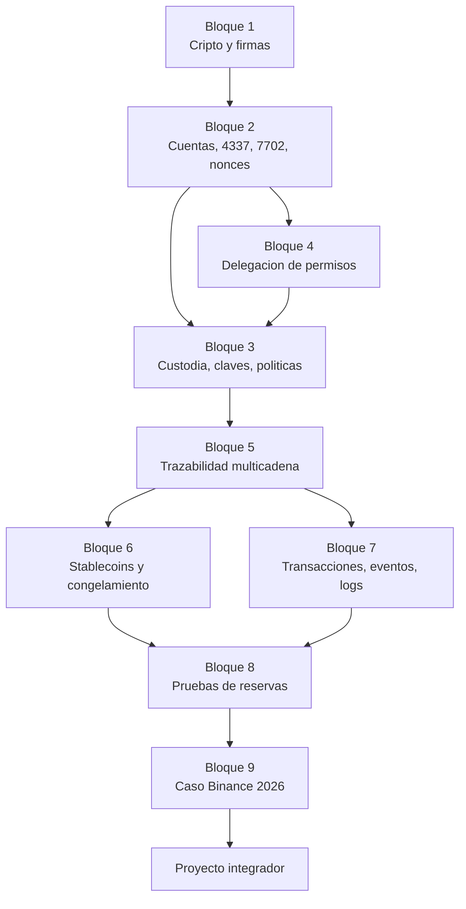

# 🛡️ Especialización avanzada en seguridad blockchain, custodia e investigación de incidentes

> 🧭 [🏠 Programa](../README.md) · [📚 Currículo](../curriculum/README.md) · [🧮 Matriz de integración](MATRIZ-INTEGRACION.md) · [🧪 Laboratorios](laboratorios/README.md) · [📝 Evaluación](evaluacion/README.md) · [📖 Glosario](glosario.md)

Una ruta avanzada y autónoma sobre cómo se **protege, se ataca y se investiga** la custodia de activos digitales, con un estudio de caso real y reciente: el incidente de Binance del **29 de octubre de 2026**.

> **Qué hace distinta a esta especialización.** No enseña a memorizar un incidente. Enseña a **separar lo que se sabe de lo que se supone y de lo que se ignora**, y a diseñar controles que funcionen bajo *cada* hipótesis sobre cómo ocurrió, mientras la causa raíz sigue sin publicarse.

## Qué vas a poder hacer

- Explicar qué prueba una firma digital y qué no, y detectar sus fallos clásicos (nonce repetido, maleabilidad, repetición entre contextos).
- Distinguir una cuenta EOA, un contrato, una cuenta inteligente (ERC-4337) y una EOA delegada (EIP-7702), y leer los **nonces** de cada una.
- Diseñar una arquitectura de custodia hot / warm / cold con topes, cuórums y **políticas de firma**, y decir qué amenaza cubre cada tecnología (multisig, MPC, HSM, hardware).
- Revisar un delegado de permisos y construir un **detector de delegaciones sospechosas** con evidencia explicable.
- Seguir fondos entre Ethereum, Bitcoin, Tron y redes L2, e informar la exposición como **rango con método**, sin atribuir identidad.
- Saber qué se puede **congelar** y qué no, y qué limita la recuperación.
- Leer una transacción, sus eventos y sus trazas desde un nodo, sin fiarte de un explorador.
- Explicar qué demuestra una **prueba de reservas** y por qué no habría detectado un incidente de claves.
- Escribir un informe de incidente que clasifique **hechos, hipótesis y desconocidos**.

## Para quién es y qué necesitas

| | |
|---|---|
| **Nivel** | Avanzado |
| **Duración** | 36–44 horas lectivas |
| **Prerrequisitos** | Haber cursado criptografía, Ethereum y EVM, seguridad y custodia del [currículo](../curriculum/README.md), o su equivalente |
| **Herramientas** | Node.js 22.12 o superior. Los laboratorios no requieren `npm install`, red ni claves |
| **Idioma** | Español. Los nombres de estándares se mantienen en su forma original |

## La ruta



## Los nueve bloques

| # | Bloque | Pregunta guía | Laboratorio |
|---|---|---|---|
| 1 | [Criptografía asimétrica y firmas digitales](bloques/01-criptografia-asimetrica-y-firmas.md) | ¿Qué queda demostrado cuando una wallet firma? | [LE1](laboratorios/LE1-billeteras-de-prueba.md), [LE2](laboratorios/LE2-firmas-digitales.md) |
| 2 | [Cuentas EOA, contratos y abstracción de cuentas](bloques/02-cuentas-contratos-y-abstraccion.md) | ¿Qué pasa cuando una dirección es a la vez clave y código? | [LE3](laboratorios/LE3-transferencias-simuladas.md), [LE4](laboratorios/LE4-delegacion-eip7702.md) |
| 3 | [Custodia, claves y políticas de firma](bloques/03-custodia-claves-y-politicas-de-firma.md) | ¿Cómo se comprueba que ninguna falla única mueve los fondos? | [LE8](laboratorios/LE8-monitor-riesgos-custodio.md) |
| 4 | [Riesgos de la delegación de permisos](bloques/04-delegacion-de-permisos.md) | ¿Qué poder cedes exactamente cuando concedes un permiso? | [LE4](laboratorios/LE4-delegacion-eip7702.md), [LE5](laboratorios/LE5-detector-delegaciones.md) |
| 5 | [Rastreabilidad en Ethereum, Bitcoin, Tron y L2](bloques/05-trazabilidad-multicadena.md) | ¿Cuánto de lo que se concluye es hecho y cuánto convención? | [LE6](laboratorios/LE6-explorador-transacciones.md), [LE7](laboratorios/LE7-flujos-multidireccion.md) |
| 6 | [Stablecoins, congelamientos y recuperación](bloques/06-stablecoins-congelamiento-y-recuperacion.md) | ¿Por qué un robo enorme sigue siendo en parte irrecuperable? | [LE7](laboratorios/LE7-flujos-multidireccion.md) |
| 7 | [Transacciones, eventos y logs](bloques/07-analisis-de-transacciones-eventos-y-logs.md) | ¿Cómo reconstruyo qué pasó sin confiar en el explorador de otro? | [LE6](laboratorios/LE6-explorador-transacciones.md) |
| 8 | [Pruebas de reservas y sus límites](bloques/08-pruebas-de-reservas-y-sus-limites.md) | ¿Qué has comprobado y qué sigues sin saber? | Prácticas 88–89 |
| 9 | [Caso Binance, 29 de octubre de 2026](bloques/09-caso-binance-2026-10-29.md) | ¿Qué falló, y qué de lo que se afirma sobrevivirá al informe definitivo? | LE4, LE5, LE7, LE8 |

## Los ocho laboratorios

Todos **ejecutables, offline y deterministas**, con prerrequisitos, teoría, instrucciones, código comentado, pruebas, resultados esperados, ejercicios adicionales y soluciones: [LE1 Billeteras de prueba](laboratorios/LE1-billeteras-de-prueba.md) · [LE2 Firmas](laboratorios/LE2-firmas-digitales.md) · [LE3 Transferencias](laboratorios/LE3-transferencias-simuladas.md) · [LE4 Delegación EIP-7702](laboratorios/LE4-delegacion-eip7702.md) · [LE5 Detector de delegaciones](laboratorios/LE5-detector-delegaciones.md) · [LE6 Explorador](laboratorios/LE6-explorador-transacciones.md) · [LE7 Flujos entre direcciones](laboratorios/LE7-flujos-multidireccion.md) · [LE8 Monitor para custodios](laboratorios/LE8-monitor-riesgos-custodio.md). Índice y reglas comunes en [laboratorios](laboratorios/README.md).

```bash
pnpm lab:le4   # delegación EIP-7702 en una red de laboratorio
pnpm lab:le8   # monitor de riesgos para custodios
```

## El estudio de caso: tres categorías y una prohibición

El [bloque 9](bloques/09-caso-binance-2026-10-29.md) clasifica cada afirmación como **hecho confirmado**, **hipótesis** o **desconocido**, con su fuente y la fecha de corte (30 de octubre de 2026), y explica por qué cifras distintas del mismo evento pueden ser todas correctas. **No atribuye conducta a ninguna persona**: la autoría a un grupo es una evaluación de terceros, y el acceso inicial es una cadena de ataque, no una responsabilidad individual.

Es un **estudio vivo**: incluye el procedimiento para actualizarlo cuando Binance publique su informe técnico.

## Evaluación

Cuatro componentes: cuestionarios por bloque (20 %), laboratorios (40 %), informe del caso (25 %) y proyecto integrador (15 %). Hay una lista de **faltas críticas** que anulan la aprobación, como atribuir identidad o presentar una hipótesis como hecho. Detalle en [evaluación](evaluacion/README.md), [rúbricas](evaluacion/rubricas.md) y [banco de preguntas](evaluacion/banco-de-preguntas.md).

## Cómo se integra con el programa

| Qué | Cómo |
|---|---|
| **Las 66 clases y sus 33 unidades** | No cambian. La [matriz de integración](MATRIZ-INTEGRACION.md) indica, para cada unidad, si la especialización la amplía directamente, la complementa o la contextualiza |
| **Las 91 prácticas** | No cambian ni se renumeran. Los laboratorios se identifican como LE1–LE8 |
| **El capstone** | Sigue vigente. El proyecto integrador puede apoyarse en él |
| **La numeración** | Intacta. La especialización es un directorio aparte, no una unidad más |

Las unidades con **ampliación directa** enlazan a esta especialización desde su propio README, de modo que quien sigue el currículo la encuentra en el punto exacto donde profundiza.

### Autonomía

Este repositorio conserva su autonomía. **La especialización no se fusiona con otros programas ni depende de ellos**: todo lo que necesita está aquí. Los programas hermanos —por ejemplo los de finanzas o de ciberseguridad— pueden complementarla, pero no forman parte de ella ni se copian en ella.

## Reglas innegociables

1. **Solo claves de prueba.** Nunca claves, semillas o endpoints privados en un laboratorio ni en una bitácora.
2. **Sin red por defecto.** El único modo con red (LE6 en vivo) es opcional, explícito y de solo lectura.
3. **Datos sintéticos.** Ninguna dirección, hash ni importe de los laboratorios corresponde a una persona o entidad real.
4. **Nada ofensivo.** La red de laboratorio no ejecuta bytecode; no hay nada que desplegar en una red real.
5. **Una dirección no es una persona.** Toda inferencia lleva su categoría y su confianza. Aplica [¿Y si cruzas la línea?](../docs/y-si-cruzas-la-linea-blockchain.md).

## Cómo comprobar que todo funciona

```bash
node scripts/check-repository.mjs      # estructura, enlaces, cifras y matriz de integración
node scripts/run-tests.mjs             # todas las pruebas del programa, incluidas las de la especialización
```

## Documentación de apoyo

- [Matriz de integración por unidad](MATRIZ-INTEGRACION.md)
- [Glosario](glosario.md)
- [Guía del instructor](GUIA-DEL-INSTRUCTOR.md)
- [Evaluación](evaluacion/README.md), [rúbricas](evaluacion/rubricas.md) y [banco de preguntas](evaluacion/banco-de-preguntas.md)

## Límites que conviene declarar

- El estudio de caso se apoya en **informes de empresas de análisis y en prensa**, no en un informe técnico de la entidad afectada, que aún no existe. Varias cifras son de una sola fuente.
- Los laboratorios usan **datos sintéticos y una red simulada**: validan el método, no los umbrales de producción.
- MPC, multisig y hardware wallets se estudian de forma **comparativa**, sin laboratorio de implementación.
- Es una formación técnica y metodológica. **No es asesoría legal, financiera ni de inversión**, y no sustituye a una auditoría.

## 🧭 Navegación

[🏠 Programa](../README.md) · [📚 Currículo](../curriculum/README.md) · [🧮 Matriz](MATRIZ-INTEGRACION.md) · [🧪 Laboratorios](laboratorios/README.md) · [📝 Evaluación](evaluacion/README.md) · [📖 Glosario](glosario.md) · [👩‍🏫 Instructor](GUIA-DEL-INSTRUCTOR.md)
