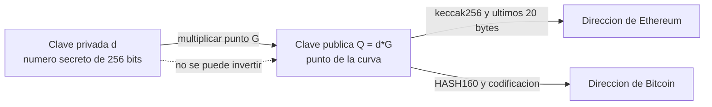

# Bloque 1 · Criptografía asimétrica y firmas digitales

> 🧭 [🛡️ Especialización](../README.md) · ➡️ [Bloque 2 · Cuentas, contratos y abstracción](02-cuentas-contratos-y-abstraccion.md) · [🧪 Laboratorios](../laboratorios/README.md) · [📖 Glosario](../glosario.md)

**Nivel:** avanzado · **Duración:** 3–4 h · **Prerrequisitos:** [clases 3–4](../../curriculum/01-criptografia/README.md) y [Wallets desde cero](../../docs/wallets-desde-cero.md) · **Laboratorios:** [LE1](../laboratorios/LE1-billeteras-de-prueba.md) y [LE2](../laboratorios/LE2-firmas-digitales.md) · **Amplía:** [unidad de criptografía](../../curriculum/01-criptografia/README.md), [unidad de Ethereum y EVM](../../curriculum/05-ethereum-evm/README.md)

## Punto de partida

**Pregunta guía:** cuando una wallet "firma", ¿qué es exactamente lo que queda demostrado?

Casi todos los incidentes de custodia de esta especialización terminan en la misma frase: *"la firma era válida"*. Un contrato aceptó una transacción, una red aplicó una delegación, un monitor no vio nada raro, y todo fue correcto desde el punto de vista criptográfico. Este bloque enseña qué garantiza una firma y, con la misma precisión, qué **no** garantiza, porque en esa diferencia viven los ataques.

## Del secreto a la cuenta

Una cuenta de Ethereum o de Bitcoin no se "crea" en ningún sitio. Se **calcula**:



- **La clave privada** es un entero `d` entre 1 y `n − 1`, donde `n` es el orden de la curva. Todo lo que importa de ella es que sea imposible de adivinar y de repetir.
- **La clave pública** es el punto `Q = d·G`, con `G` el generador fijo de la curva **secp256k1**. Calcularla desde `d` es rápido; recuperar `d` desde `Q` es el *problema del logaritmo discreto en curvas elípticas*, que hoy se considera inviable para curvas de este tamaño.
- **La dirección** es un resumen de `Q`. En Ethereum son los últimos 20 bytes de `keccak256(Q)`. No es la clave: es una huella de ella.

Dos consecuencias prácticas. Primera: **quien conoce `d` *es* esa cuenta**; no hay registro, contraseña ni segundo factor que lo impida. Segunda: dos personas no pueden "compartir" una dirección con seguridad, porque compartir `d` es entregar el control total e irrevocable.

> **Billeteras de prueba.** En [LE1](../laboratorios/LE1-billeteras-de-prueba.md) una billetera se deriva de una etiqueta pública como `"alice"`. Su clave es conocida por construcción, así que no vale nada y es segura de usar en un laboratorio. Una clave real se distingue por lo contrario: **no se puede recomputar**. Esa es la definición operativa de "secreta".

### Direcciones y errores de tipeo

EIP-55 usa las mayúsculas y minúsculas de la dirección como suma de verificación. Una dirección con mayúsculas alteradas es inválida; una escrita toda en minúsculas es válida **pero no se puede comprobar**. LE1 mide que el cambio de una sola mayúscula se detecta siempre. La lección operativa: copia las direcciones con su checksum y rechaza las que lo incumplen.

## ECDSA: cómo se firma y por qué importa el nonce

Para firmar un hash `z` con la clave `d`, ECDSA elige un número secreto `k` (el **nonce de firma**), calcula el punto `R = k·G` y produce el par `(r, s)`:

```text
r = x(R) mod n
s = k⁻¹ · (z + r·d) mod n
```

Verificar es comprobar que la ecuación se cumple con la clave pública `Q`, sin conocer `d` ni `k`.

### El nonce `k` es tan secreto como la clave

Si dos firmas distintas con la misma clave usan el mismo `k`, ambas tienen el mismo `r`, y restar las dos ecuaciones elimina `d`:

```text
s₁ − s₂ = k⁻¹ · (z₁ − z₂)   →   k = (z₁ − z₂) / (s₁ − s₂)   →   d = (s₁·k − z₁) / r
```

Quien vea dos firmas con el mismo `r` despeja la **clave privada completa**. Ocurrió en consolas de videojuegos y en billeteras Android con generadores aleatorios defectuosos. [LE2](../laboratorios/LE2-firmas-digitales.md) lo reproduce con claves de prueba y lo detecta por la huella visible: **dos firmas con el mismo `r`**.

La defensa estándar es derivar `k` de forma **determinista** a partir de la clave y del mensaje ([RFC 6979](https://www.rfc-editor.org/rfc/rfc6979)): no depende de un generador aleatorio, así que no puede fallar por entropía pobre. Es lo que usan las bibliotecas serias y lo que hace el núcleo del laboratorio.

### Maleabilidad y la regla "low-s"

Si `(r, s)` es una firma válida, también lo es `(r, n − s)`. Terceros pueden, sin conocer la clave, convertir una firma en su gemela. Ethereum lo evita exigiendo `s ≤ n/2` ([EIP-2](https://eips.ethereum.org/EIPS/eip-2)): así cada firma tiene una única forma aceptada. **No identifiques una transacción por el hash de su firma**; identifícala por su contenido.

### El bit de recuperación: de una firma a una dirección

La firma de Ethereum añade un bit `v` (la paridad de `y` en `R`). Con `(r, s, v)` y el hash, se puede **recuperar** la clave pública (`ecrecover`) y, de ella, la dirección. Por eso una transacción de Ethereum **no lleva campo "remitente"**: el remitente es *quien firmó*.

Recuperar no es verificar. `ecrecover` siempre devuelve alguna dirección; la verificación consiste en **compararla con la esperada**. Un contrato que recupera una dirección y no la compara con nada ha verificado que "alguien firmó algo".

## Qué se firma: cuatro familias de mensaje

La misma clave firma cosas con efectos muy distintos. Saber en cuál estás es la defensa principal.

| Familia | Qué se firma | Estándar | Efecto |
|---|---|---|---|
| Mensaje personal | Texto con prefijo `"\x19Ethereum Signed Message:\n" + longitud` | [EIP-191](https://eips.ethereum.org/EIPS/eip-191) | Probar control de una dirección; el prefijo impide que un texto sea una transacción válida |
| Datos tipados | Estructura con dominio (cadena, contrato, versión) | [EIP-712](https://eips.ethereum.org/EIPS/eip-712) | Autorizaciones fuera de cadena que un contrato verifica (por ejemplo, un `permit`) |
| Transacción | Cuerpo RLP con prefijo de tipo | [EIP-1559](https://eips.ethereum.org/EIPS/eip-1559), [EIP-155](https://eips.ethereum.org/EIPS/eip-155) | Mover valor o ejecutar código desde la cuenta |
| Autorización de delegación | `0x05 ‖ rlp([chain_id, address, nonce])` | [EIP-7702](https://eips.ethereum.org/EIPS/eip-7702) | **Sustituir el código de la cuenta** |

La última fila es nueva y cambia el cálculo de riesgo: una firma de pocas decenas de bytes puede cederle a un contrato el control de toda la cuenta, y no pasa por ninguna transacción de esa cuenta. Se estudia en los bloques [2](02-cuentas-contratos-y-abstraccion.md) y [4](04-delegacion-de-permisos.md).

### Separación de dominios y repetición

Una firma sobre "pagar 10" es válida **dondequiera que se presente**. Para que no se pueda reutilizar, lo firmado debe incluir su contexto: **cadena, contrato destino, nonce y caducidad**. Sin cadena, la misma firma sirve en otra red (por eso EIP-155 mete el `chainId` en las transacciones). Sin nonce, sirve dos veces. Sin caducidad, sirve para siempre. [LE2](../laboratorios/LE2-firmas-digitales.md) construye un verificador que rechaza cada una de esas repeticiones.

## Qué prueba una firma y qué no

| Una firma válida **prueba** | Una firma válida **no prueba** |
|---|---|
| Que quien la produjo conocía la clave privada de esa dirección | Quién es la persona detrás |
| Que esos bytes exactos fueron firmados | Que el firmante entendió lo que firmaba |
| Que el mensaje no se alteró después | Que el firmante estaba bajo su propio control |
| (Con dominio y nonce) que no es una repetición | Que la clave no esté comprometida |

La última fila es la que domina en custodia: si el atacante tiene la clave, o puede hacer que el servicio de firma la use, **sus firmas son tan válidas como las del titular**. Ningún análisis criptográfico las distingue. La distinción solo puede venir de **contexto**: ¿hubo una solicitud aprobada?, ¿el destino estaba permitido?, ¿el nonce coincide con el que el sistema esperaba? Es el objeto de los bloques [3](03-custodia-claves-y-politicas-de-firma.md) y [9](09-caso-binance-2026-10-29.md).

## Otras familias de firma

- **Schnorr ([BIP-340](https://github.com/bitcoin/bips/blob/master/bip-0340.mediawiki)).** Usada por Taproot en Bitcoin. Su estructura lineal permite **agregar** firmas de varios participantes en una sola, indistinguible de una firma ordinaria (MuSig2, [BIP-327](https://github.com/bitcoin/bips/blob/master/bip-0327.mediawiki)). Es la base de un multisig que en cadena parece una cuenta normal.
- **Umbral (FROST, [RFC 9591](https://www.rfc-editor.org/rfc/rfc9591)).** Reparte la clave entre varios participantes de modo que `t` de `n` puedan firmar sin que la clave completa exista jamás en un solo lugar. Se estudia en el [bloque 3](03-custodia-claves-y-politicas-de-firma.md).
- **BLS.** Agrega firmas de miles de validadores en consenso. No se usa para cuentas de usuario de Ethereum.
- **Ed25519.** Usada en Solana, XRP Ledger y otras. Es determinista por diseño y evita la clase de fallo del nonce repetido, pero no es compatible con las herramientas de secp256k1.
- **Poscuánticas.** NIST ha estandarizado esquemas como [ML-DSA](https://csrc.nist.gov/pubs/fips/204/final). Un ordenador cuántico suficientemente grande rompería ECDSA; la exposición real depende de si la clave pública ya es visible (una dirección que nunca ha gastado solo muestra un resumen). La migración es una decisión de planificación, no de emergencia, pero un custodio debe saber qué direcciones han expuesto su clave.

## Generación, almacenamiento y derivación de claves

- **Entropía.** Una clave generada con un generador predecible no es secreta aunque parezca aleatoria. Usa el generador criptográfico del sistema operativo y no pseudoaleatoriedad de aplicación.
- **Frase semilla y derivación.** [BIP-39](https://github.com/bitcoin/bips/blob/master/bip-0039.mediawiki) codifica entropía como palabras y [BIP-32](https://github.com/bitcoin/bips/blob/master/bip-0032.mediawiki) deriva un árbol de claves desde ella. Una semilla controla *todas* las cuentas derivadas: protegerla es proteger todo.
- **Ciclo de vida.** [NIST SP 800-57](https://csrc.nist.gov/pubs/sp/800/57/pt1/r5/final) distingue generación, distribución, almacenamiento, uso, rotación, revocación y destrucción. Cada etapa es una superficie de ataque. Se desarrolla en el [bloque 3](03-custodia-claves-y-politicas-de-firma.md).
- **Claves de prueba.** Nunca uses una clave de laboratorio para valor real, ni una real en un laboratorio. Las prácticas del programa prohíben incluso semillas de testnet en la evidencia.

## Errores frecuentes

- **Confundir "firma válida" con "operación legítima".** Es el error que este bloque existe para corregir.
- **Recuperar sin comparar.** `ecrecover` devuelve siempre una dirección.
- **Firmar sin dominio.** Sin cadena, contrato, nonce y caducidad, la firma se puede reusar.
- **Identificar por hash de firma.** La firma es maleable; el contenido no.
- **Reutilizar `k`.** Ya es una fuga total de la clave.
- **Tratar una dirección como una identidad.** Es un resumen de una clave, no una persona.

## Comprobación

1. ¿Qué se necesita para despejar una clave privada desde dos firmas ECDSA y qué indicio visible lo delata?
2. ¿Por qué una transacción de Ethereum no necesita un campo "remitente"?
3. Una firma EIP-7702 y un mensaje personal usan la misma clave. ¿Por qué tienen efectos tan distintos y qué impide confundirlos?
4. Un contrato recupera la dirección de una firma y la usa como "autorizada". ¿Qué comprobación falta?
5. ¿Qué tres elementos debe contener lo firmado para que no pueda reutilizarse?

**Respuestas orientadoras.** (1) Dos firmas con el mismo `r` (mismo `k`); (2) el remitente se recupera de `(r, s, v)`; (3) el prefijo de dominio (`0x05` frente a `\x19Ethereum Signed Message`), que separa lo que se firma; (4) comparar con la dirección esperada; (5) cadena, nonce y caducidad (y contrato destino).

## Fuentes

- [FIPS 186-5 · Digital Signature Standard](https://csrc.nist.gov/pubs/fips/186-5/final) · [RFC 6979 · ECDSA determinista](https://www.rfc-editor.org/rfc/rfc6979)
- [EIP-191](https://eips.ethereum.org/EIPS/eip-191), [EIP-712](https://eips.ethereum.org/EIPS/eip-712), [EIP-155](https://eips.ethereum.org/EIPS/eip-155), [EIP-2](https://eips.ethereum.org/EIPS/eip-2), [EIP-55](https://eips.ethereum.org/EIPS/eip-55)
- [BIP-32](https://github.com/bitcoin/bips/blob/master/bip-0032.mediawiki), [BIP-39](https://github.com/bitcoin/bips/blob/master/bip-0039.mediawiki), [BIP-340](https://github.com/bitcoin/bips/blob/master/bip-0340.mediawiki)
- [NIST SP 800-57 · Gestión de claves](https://csrc.nist.gov/pubs/sp/800/57/pt1/r5/final)

## ✅ Criterio de dominio

Puedes explicar, con una firma real delante, qué se ha demostrado y qué no; detectar un nonce repetido; y diseñar un mensaje firmado que no pueda reutilizarse en otra cadena, otro contrato o dos veces.

## 🧭 Navegación

[🛡️ Especialización](../README.md) · ➡️ [Bloque 2 · Cuentas, contratos y abstracción](02-cuentas-contratos-y-abstraccion.md) · [🧪 LE1](../laboratorios/LE1-billeteras-de-prueba.md) · [🧪 LE2](../laboratorios/LE2-firmas-digitales.md) · [🏠 Programa](../../README.md)
