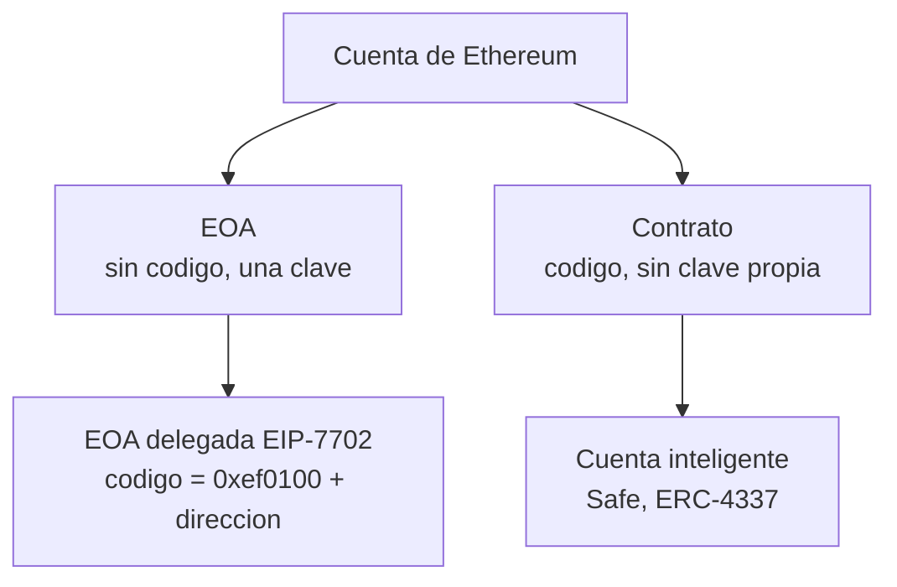
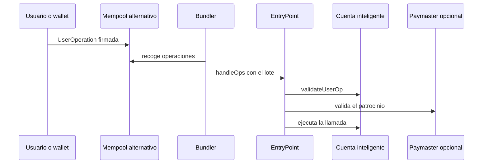

# Bloque 2 · Cuentas EOA, contratos inteligentes y abstracción de cuentas

> 🧭 [⬅️ Bloque 1 · Criptografía y firmas](01-criptografia-asimetrica-y-firmas.md) · [🛡️ Especialización](../README.md) · ➡️ [Bloque 3 · Custodia y claves](03-custodia-claves-y-politicas-de-firma.md) · [📖 Glosario](../glosario.md)

**Nivel:** avanzado · **Duración:** 4–5 h · **Prerrequisitos:** bloque 1 y [clases 9–10](../../curriculum/04-bitcoin/README.md), [clases 11–12](../../curriculum/05-ethereum-evm/README.md) · **Laboratorios:** [LE3](../laboratorios/LE3-transferencias-simuladas.md) y [LE4](../laboratorios/LE4-delegacion-eip7702.md) · **Amplía:** [unidad de Ethereum y EVM](../../curriculum/05-ethereum-evm/README.md), [unidad de arquitectura avanzada](../../curriculum/15-arquitectura-avanzada/README.md)

## Punto de partida

**Pregunta guía:** si una cuenta de Ethereum puede ser "solo una clave" o "solo código", ¿qué pasa cuando una misma dirección pasa a ser las dos cosas?

Durante años la regla fue sencilla: una **EOA** (cuenta de propiedad externa) la controla una clave y no tiene código; un **contrato** tiene código y no tiene clave. Casi toda la seguridad de wallets, exchanges y contratos se construyó sobre esa dicotomía. EIP-7702 la rompe, y por eso este bloque es la base del caso del [bloque 9](09-caso-binance-2026-10-29.md).

## Dos modelos de contabilidad

| | Modelo UTXO (Bitcoin) | Modelo de cuentas (Ethereum, Tron) |
|---|---|---|
| Qué existe | Salidas de transacción sin gastar | Cuentas con saldo, nonce, código y almacenamiento |
| Qué es una "dirección" | Un patrón de bloqueo; se suele usar una nueva por pago | Un identificador estable |
| Qué impide repetir un pago | La salida ya gastada deja de existir | El **nonce** de la cuenta |
| Estado global | No hay: solo el conjunto de UTXO | Sí: árbol de estado |
| Programabilidad | Scripts limitados | Contratos arbitrarios |

El modelo de cuentas da programabilidad, pero también da algo que Bitcoin no tiene: **un contador de la cuenta que se puede consumir desde fuera**. Mucho de lo que sigue trata de ese contador.

## Los cuatro tipos de cuenta que debes saber distinguir

| Tipo | Código | Quién puede ordenar | Inicia transacciones | Recuperación de acceso |
|---|---|---|---|---|
| **EOA** | Vacío | Quien tenga la clave | Sí | Ninguna: si pierdes la clave, pierdes la cuenta |
| **Contrato** | Sí | Las reglas del código | No (solo reacciona) | Depende del diseño |
| **EOA delegada (EIP-7702)** | `0xef0100` ‖ dirección del delegado (23 bytes) | La clave **y** las reglas del código delegado | Sí | Depende del delegado; la clave sigue mandando |
| **Cuenta inteligente** | Sí | Reglas de validación del contrato | A través de un punto de entrada (ERC-4337) | Diseñable: guardianes, multifirma |

El nonce de una EOA cuenta las transacciones que ha enviado. El de un contrato cuenta los contratos que ha creado.

## Contratos como cuentas: multifirma y validación de firmas

Un contrato puede actuar como cuenta si define **cómo valida una firma**. El estándar ERC-1271 le da una función `isValidSignature` que otros contratos consultan en vez de hacer `ecrecover`. Así un **multisig on-chain** (por ejemplo Safe, ver su [documentación](https://docs.safe.global/)) acepta una operación cuando `m` de `n` propietarios firman.

Lo importante para custodia: la política de firma vive **en código auditable y on-chain**, no en un servidor privado. A cambio, el contrato es una superficie de ataque propia (errores del código, manipulación de la interfaz que muestra qué se firma, cambio de propietarios). El [bloque 3](03-custodia-claves-y-politicas-de-firma.md) compara este enfoque con MPC.

## ERC-4337: abstracción de cuentas sin cambiar el protocolo

[ERC-4337](https://eips.ethereum.org/EIPS/eip-4337) permite cuentas inteligentes **sin modificar el consenso**, introduciendo un mercado paralelo de "operaciones de usuario":

- **UserOperation.** Una orden firmada que no es una transacción. Lleva su propio nonce.
- **Bundler.** Nodo que agrupa operaciones y las envía como una transacción normal a cambio de una comisión.
- **EntryPoint.** Contrato único y común que valida y ejecuta. Su corrección es crítica para todo el ecosistema.
- **Cuenta inteligente.** Define su propia validación: multifirma, claves de sesión, recuperación social, límites de gasto.
- **Paymaster.** Contrato que paga el gas en nombre del usuario (patrocinio) bajo sus condiciones.

### Nonces con carriles

El nonce de una `UserOperation` tiene 256 bits: una **clave** de 192 bits y una **secuencia** de 64. Cada clave es un "carril" con su propio contador, de modo que operaciones independientes pueden ir en paralelo sin bloquearse. En una EOA, en cambio, hay un solo carril: una transacción pendiente con un nonce bloquea a todas las demás.

## EIP-7702: una EOA que adopta código

[EIP-7702](https://eips.ethereum.org/EIPS/eip-7702) llegó con la actualización Pectra ([anuncio](https://blog.ethereum.org/en/2025/04/23/pectra-mainnet)). Permite que una EOA diga "adopto el código de este contrato", sin cambiar de dirección y sin mover fondos.

### Cómo funciona

1. La cuenta (la **autoridad**) firma una **autorización**: `keccak256(0x05 ‖ rlp([chain_id, address, nonce]))`.
2. Cualquiera incluye esa firma en una transacción **tipo 4**, cuya lista de autorizaciones es `[[chain_id, address, nonce, y_parity, r, s], …]`.
3. Antes de ejecutar, la red procesa la lista **en orden**. Para cada tupla comprueba, entre otras cosas: que `chain_id` sea 0 o el de la cadena; que la firma sea canónica (`s ≤ n/2`); que la cuenta no sea un contrato; y que el **nonce de la cuenta coincida con el de la tupla**. Si todo cuadra, escribe en el código de la cuenta el **designador** `0xef0100 ‖ address` y **incrementa su nonce**.
4. Una tupla que falla se **omite** sin invalidar la transacción. El remitente paga todas, valgan o no.
5. Si la misma cuenta aparece varias veces, **gana la última tupla válida**.

Con el designador instalado, cualquier llamada a la cuenta ejecuta el código del delegado, con el almacenamiento y el saldo **de la cuenta delegante**.

### Propiedades que cambian el modelo de riesgo

| Propiedad | Consecuencia |
|---|---|
| **Persistencia.** La delegación dura hasta que se firme otra; no caduca ni se consume | Un fondo que llegue después de la delegación también queda al alcance del delegado |
| **Firma desconectada.** La autorización la puede publicar un tercero | La cuenta delegante **no envía ninguna transacción**. Un monitor que mire solo "tx enviadas por esta cuenta" no ve nada |
| **`chain_id = 0`.** Válida en cualquier cadena | Una firma robada sirve en todas las redes a la vez |
| **Orden de procesamiento.** Secuencial | Una lista de nonces consecutivos puede aplicar una tupla o varias, según el orden ([LE4](../laboratorios/LE4-delegacion-eip7702.md)) |
| **El nonce avanza al delegar** | Delegar consume un nonce de la cuenta; un salto de nonce sin transacción propia es una señal de detección |
| **Revocación** | Se revoca firmando una autorización a la dirección cero, que restaura la cuenta a EOA. Requiere la clave |
| **`tx.origin` y `extcodesize`** | Las suposiciones "quien llama es una EOA" dejan de ser fiables. `EXTCODESIZE` de una cuenta delegada devuelve 23 |

### Nonce del remitente cuando también es la autoridad

El nonce del remitente se incrementa **antes** de procesar las autorizaciones. Una consecuencia directa de ese orden: si el remitente firma su propia autorización, esta debe llevar **su nonce de transacción + 1**; con el nonce actual quedará inerte. Si la envía otro, la autorización lleva el nonce actual de la autoridad. [LE4](../laboratorios/LE4-delegacion-eip7702.md) lo comprueba en ambos casos.

### Consideraciones de seguridad de la especificación

La propia especificación advierte, entre otras, de lo siguiente:

- **Inicialización expuesta.** Al no haber `initcode`, un observador puede adelantarse a la inicialización del delegado. Debe exigirse que los datos de inicialización estén firmados por la clave de la cuenta.
- **Repetición.** Un delegado debe incluir un nonce propio en lo que verifica, porque sin él una firma puede reutilizarse.
- **Colisión de almacenamiento.** Cambiar de delegado es crítico; los delegados deberían usar diseños de almacenamiento a prueba de colisión ([ERC-7201](https://eips.ethereum.org/EIPS/eip-7201)).
- **Patrocinio.** La autoridad puede dejar sin pagar a un patrocinador subiendo su nonce o vaciando la cuenta.
- **Interfaz de la wallet.** Las aplicaciones no deben esperar poder pedir autorizaciones; las wallets deben auditar el código delegado.

## Nonces: un mapa de los cinco contadores

La palabra "nonce" designa cosas distintas. Confundirlas es una fuente constante de errores y, en el caso del [bloque 9](09-caso-binance-2026-10-29.md), el núcleo del mecanismo.

| Nonce | Quién lo lleva | Qué protege | Quién puede consumirlo |
|---|---|---|---|
| Nonce de cuenta (EOA) | La red | Orden y no repetición de transacciones | Quien tenga la clave, también mediante una autorización EIP-7702 |
| Nonce de autorización | La tupla EIP-7702 | Que la autorización solo valga para un estado de la cuenta | Se compara con el nonce actual de la cuenta |
| Nonce de `UserOperation` | El `EntryPoint` | Orden por carril | La cuenta inteligente y su validación |
| Nonce interno del delegado | El almacenamiento de la cuenta | Que una instrucción firmada no se repita | El delegado |
| Nonce de firma ECDSA (`k`) | Quien firma | Secreto de la clave (no es un contador) | Nadie debe verlo ni repetirlo ([bloque 1](01-criptografia-asimetrica-y-firmas.md)) |

## Qué debe cambiar en un custodio

1. **Clasificar cuentas por código, no por tipo.** Vigilar `eth_getCode` de cada dirección gestionada. Un valor que empiece por `0xef0100` indica delegación.
2. **Reconciliar el nonce.** El nonce on-chain debe coincidir con el que el sistema espera. Un salto indica firmas consumidas fuera del flujo.
3. **No dar por buenas las listas de "solo EOA".** Cualquier control que dependa de `extcodesize == 0` ya no es fiable.
4. **Impedir en la política de firma las autorizaciones no previstas.** Las claves de billetera caliente no deberían firmar nunca mensajes `0x05` salvo en un procedimiento aprobado.
5. **Mantener una lista de delegados aprobados.** Código revisado, desplegado y verificado.

## Errores frecuentes

- **Creer que una EOA sigue siendo "solo una clave".** Con EIP-7702 puede tener código.
- **Vigilar solo las transacciones salientes.** La autorización viaja en una transacción ajena.
- **Pensar que 50 autorizaciones aplican 50 veces.** Depende del orden; puede aplicar una o varias.
- **Olvidar que delegar gasta un nonce.** Y que ese gasto es observable.
- **Creer que ERC-4337 y EIP-7702 compiten.** Son compatibles: 7702 puede dar a una EOA el comportamiento de una cuenta 4337.

## Comprobación

1. ¿Qué dos efectos tiene sobre una cuenta aplicar con éxito una tupla EIP-7702?
2. ¿Por qué un monitor de "transacciones enviadas por la billetera" no detecta una delegación ajena?
3. Una cuenta firma su propia autorización con el nonce de su transacción. ¿Por qué no se aplica?
4. ¿Qué diferencia hay entre el nonce de una cuenta y el nonce de carril de una `UserOperation`?
5. Un control permite pagos solo a direcciones sin código. ¿Qué debilidad introduce EIP-7702?

**Respuestas orientadoras.** (1) Instala el designador en el código y avanza el nonce; (2) la autoridad no envía ninguna transacción, la envía un tercero; (3) el nonce del remitente ya avanzó antes de procesar, así que debe firmar nonce + 1; (4) un único contador frente a carriles independientes; (5) cualquier EOA puede tener código, así que "sin código" ya no implica "persona".

## Fuentes

- [EIP-7702](https://eips.ethereum.org/EIPS/eip-7702) · [ERC-4337](https://eips.ethereum.org/EIPS/eip-4337) · [ERC-7201](https://eips.ethereum.org/EIPS/eip-7201)
- [Pectra: anuncio de la red principal](https://blog.ethereum.org/en/2025/04/23/pectra-mainnet) · [Ethereum.org · cuentas](https://ethereum.org/en/developers/docs/accounts/)
- [Documentación de Safe](https://docs.safe.global/)

## ✅ Criterio de dominio

Puedes decir, mirando un valor de `eth_getCode` y un nonce, qué clase de cuenta tienes delante; explicar por qué una delegación puede ocurrir sin que la cuenta envíe nada; y señalar qué controles de custodia dejan de ser válidos.

## 🧭 Navegación

⬅️ [Bloque 1 · Criptografía y firmas](01-criptografia-asimetrica-y-firmas.md) · [🛡️ Especialización](../README.md) · ➡️ [Bloque 3 · Custodia y claves](03-custodia-claves-y-politicas-de-firma.md) · [🧪 LE3](../laboratorios/LE3-transferencias-simuladas.md) · [🧪 LE4](../laboratorios/LE4-delegacion-eip7702.md) · [🏠 Programa](../../README.md)
