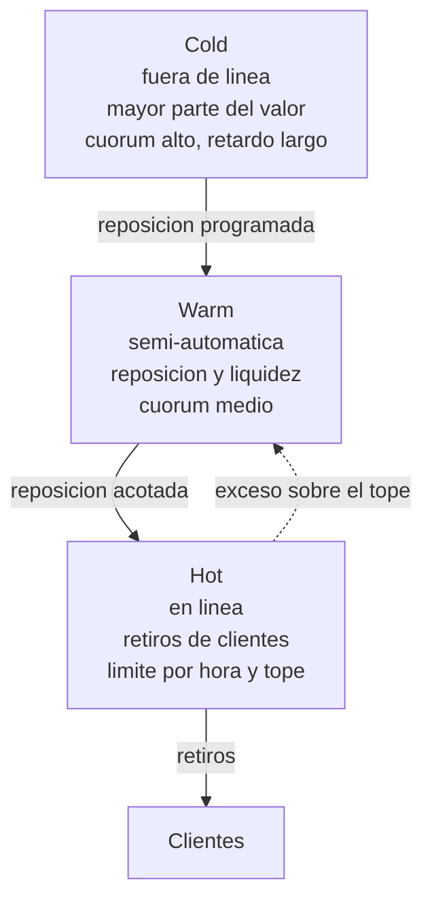
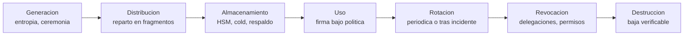

# Bloque 3 · Custodia hot, warm y cold; MPC, multisig y hardware; gestión de claves y políticas de firma

> 🧭 [⬅️ Bloque 2 · Cuentas y abstracción](02-cuentas-contratos-y-abstraccion.md) · [🛡️ Especialización](../README.md) · ➡️ [Bloque 4 · Delegación de permisos](04-delegacion-de-permisos.md) · [📖 Glosario](../glosario.md)

**Nivel:** avanzado · **Duración:** 5–6 h · **Prerrequisitos:** bloques 1 y 2, [clases 53–54](../../curriculum/26-custodia-identidad/README.md) y [clases 59–60](../../curriculum/29-exchanges-operaciones-custodia/README.md) · **Laboratorios:** [LE8](../laboratorios/LE8-monitor-riesgos-custodio.md) y las prácticas 84–85 del [catálogo](../../labs/CATALOG.md) · **Amplía:** [unidad de custodia](../../curriculum/26-custodia-identidad/README.md), [unidad de exchanges](../../curriculum/29-exchanges-operaciones-custodia/README.md)

## Punto de partida

**Pregunta guía:** si el objetivo de una custodia es que ninguna persona ni ningún fallo único pueda mover los fondos, ¿cómo se comprueba que *de verdad* ocurre así?

Una arquitectura de custodia no se juzga por cuántas claves tiene sino por **cuánto valor puede perderse y en cuánto tiempo, si falla lo peor que puede fallar**. Este bloque da el vocabulario para medirlo.

## El modelo de amenazas de una custodia

Una custodia se defiende de seis cosas distintas. Un control que cubre una no cubre necesariamente otra.

| Amenaza | Ejemplo | Control principal |
|---|---|---|
| Robo externo de la clave | Malware en un equipo que toca el material de firma | Aislamiento, HSM, MPC, topes |
| Abuso del servicio de firma | Un atacante envía órdenes válidas por tu propio sistema | Políticas de firma, aprobación independiente, detección |
| Fraude interno | Un empleado con permisos mueve fondos | Separación de funciones, doble control |
| Pérdida de la clave | Un disco falla y nadie tiene copia | Respaldos, reparto, ensayos de recuperación |
| Coerción o ingeniería social | Se engaña al aprobador | Verificación independiente de lo que se firma, retardos |
| Fallo o compromiso del proveedor | La empresa de MPC cae o es atacada | Diversificación, salida pactada |

> **Una custodia con una sola capa de protección ante la amenaza 2 tiene el mismo riesgo que una sin ninguna.** Muchos incidentes grandes son del tipo 2: el atacante no rompe la criptografía, usa la infraestructura legítima.

## Hot, warm y cold: capas por propósito, no por moda



| Capa | Propósito | Valor que debe contener | Control de salida | Tiempo de operación |
|---|---|---|---|---|
| **Hot** | Atender retiros inmediatos | Lo mínimo para la demanda esperada (tope) | Límites por transacción y por ventana, destinos permitidos | Segundos |
| **Warm** | Reponer las hot sin tocar las cold | Reposición de unas horas o días | Cuórum mayor, destinos fijos | Minutos u horas |
| **Cold** | Reserva | El resto | Ceremonia con varios aprobadores, retardo, dispositivos aislados | Horas o días |

### La regla que determina el tamaño de la pérdida

**La pérdida máxima de una hot wallet comprometida es su saldo.** Todo lo demás —alertas, congelamientos, seguros— reduce el daño *después*. El tope es el único control que actúa **tanto si el atacante robó la clave como si abusó del servicio de firma**. [LE8](../laboratorios/LE8-monitor-riesgos-custodio.md) lo mide: con topes, el mismo ataque pasa de más de cinco millones a cerca de medio millón en unidades de laboratorio.

Corolario: la pregunta "¿por qué la hot tenía ese saldo?" es siempre la primera de un informe posterior. Un saldo alto en línea es una decisión de negocio (liquidez, costes de reposición) que compra velocidad con exposición. Debe ser explícita, aprobada y revisada.

## Tecnologías de firma: qué protege cada una

### Multifirma (multisig)

`m` de `n` firmas independientes autorizan una operación.

- **En Bitcoin** es nativa del script (P2WSH) o, con Taproot, puede ocultarse tras una firma agregada.
- **En Ethereum** se implementa con un contrato (por ejemplo [Safe](https://docs.safe.global/)) que valida las firmas de los propietarios.
- **Ventaja:** la política es pública y verificable; los propietarios son claves distintas.
- **Riesgo:** el contrato y la interfaz que muestra lo que se firma son superficie de ataque propia; y si las `n` claves comparten entorno, no hay `n` firmantes.

### MPC / firma por umbral

La clave **nunca existe completa** en ningún lugar: se reparte en fragmentos, y `t` de `n` participantes producen juntos una firma ordinaria. [FROST (RFC 9591)](https://www.rfc-editor.org/rfc/rfc9591) es un ejemplo para Schnorr.

- **Ventaja:** en cadena parece una cuenta normal; rotación de fragmentos sin cambiar de dirección; funciona igual en varias cadenas.
- **Riesgo:** el protocolo y el servicio que **orquesta** a los participantes se convierten en el objetivo. Un atacante que controle a `t` participantes, o el orquestador, firma igual.
- **Matiz clave:** MPC protege contra la *exfiltración de un fragmento*, no contra el *abuso del flujo de firma*.

### HSM (dispositivo de seguridad de hardware)

Un dispositivo certificado donde la clave se genera y **no se puede exportar**; solo firma bajo una política.

- **Ventaja:** la clave no está en memoria de un servidor general; se auditan las operaciones.
- **Riesgo:** el HSM firma lo que su política permita. Si la política es amplia o el servicio que lo invoca está comprometido, firma lo que el atacante pida. Protege la clave, no la intención.

### Billeteras de hardware

Dispositivo aislado con pantalla propia para que el firmante **vea lo que firma**.

- **Ventaja:** el equipo anfitrión comprometido no puede extraer la clave ni cambiar lo que se muestra sin que se note.
- **Riesgo:** si la pantalla no muestra los campos que importan (un aviso genérico de "firma de datos"), el aprobador firma a ciegas. La cadena de suministro y el firmware son parte de la confianza.

### Comparativa

| | Multisig on-chain | MPC | HSM | Hardware wallet |
|---|---|---|---|---|
| ¿La clave completa existe en un sitio? | Cada clave sí; la política es de `m` | No | Sí, dentro del dispositivo | Sí, dentro del dispositivo |
| ¿Visible en cadena? | Sí (excepto Taproot) | No | No | No |
| Resiste exfiltración de una clave | Sí (hasta `m − 1`) | Sí (hasta `t − 1`) | Sí (no exportable) | Sí |
| Resiste abuso del flujo de firma | Depende de la política | Depende de la política | Depende de la política | Parcial: solo si el humano verifica |
| Rotación sin cambiar de dirección | Cambia propietarios | Sí | No | No |
| Compatibilidad multicadena | Por cadena | Alta | Alta | Variable |

**La última fila de resistencia es la que casi siempre falla en los incidentes**: ninguna tecnología de firma, por sí sola, protege contra el abuso del flujo de firma. Eso lo hace la **política**.

## La independencia que importa: no es el número de claves

Un cuórum `m` de `n` solo da seguridad si los firmantes son **realmente independientes** en máquina, red, administrador, proveedor, ubicación y credenciales. Cuando varias claves comparten uno de esos elementos, hay un **punto único de compromiso con `n` copias**. El [caso del puente Ronin](../../docs/casos-reales/ronin-puente.md) es el ejemplo canónico: varias claves del mismo operador alcanzaron el umbral con un solo compromiso.

Pregunta de auditoría: *"¿qué es lo mínimo que tendría que comprometer un atacante para firmar?"* Si la respuesta es "un solo servidor", el cuórum es decorativo.

## Gestión de claves: el ciclo de vida

[NIST SP 800-57](https://csrc.nist.gov/pubs/sp/800/57/pt1/r5/final) describe las etapas por las que pasa una clave. Cada una es una superficie de ataque:



| Etapa | Qué puede salir mal | Control |
|---|---|---|
| Generación | Entropía débil; persona que ve la clave | Ceremonia con testigos, dispositivos certificados |
| Distribución | Fragmentos juntos en un mismo lugar | Reparto geográfico y de responsables (conocimiento dividido) |
| Almacenamiento | Respaldo sin cifrar; único respaldo | Respaldos cifrados, múltiples, ensayados |
| Uso | Firma fuera del flujo | Política de firma, registro inmutable, aprobación independiente |
| Rotación | Rotar solo la clave y no los permisos que ya concedió | Revocar delegaciones y aprobaciones al rotar |
| Revocación | Delegación que sigue activa tras el cambio | Inventario de delegaciones y permisos por cuenta |
| Destrucción | Copias olvidadas | Inventario de todas las copias |

Dos principios sostienen casi todo: **separación de funciones** (quien solicita no aprueba; quien aprueba no firma) y **conocimiento dividido** (ninguna persona conoce el material completo).

## Políticas de firma: donde se gana o se pierde

Una **política de firma** es el conjunto de reglas que el sistema aplica **antes de producir una firma**, sea quien sea el que la pida. Es el control que actúa sobre el abuso del flujo. Debe vivir **en la capa de firma**, no en la aplicación que pide la firma, porque la aplicación es justo lo que un atacante puede comprometer.

### Qué debe decidir una política

1. **Tipo de contenido.** ¿Es una transferencia, una llamada a contrato, un mensaje, una autorización de delegación? *Rechazar por defecto* lo que no se espera. Una billetera caliente no debería firmar jamás una autorización EIP-7702 ni una aprobación ilimitada fuera de un procedimiento aprobado.
2. **Destino.** Lista de permitidos por billetera.
3. **Importe.** Por transacción y por ventana de tiempo.
4. **Aprobaciones.** Cuórum creciente con el importe; el solicitante no puede aprobar.
5. **Retardo.** Un retraso en los importes grandes da tiempo a detectar.
6. **Contexto.** ¿Hay un ticket asociado? ¿El horario es el esperado?

### Ejemplo de política como código

```json
{
  "billetera": "hot-eth",
  "tiposPermitidos": ["transferencia", "llamada-a-contrato-permitido"],
  "tiposProhibidos": ["autorizacion-eip7702", "aprobacion-ilimitada", "firma-ciega"],
  "destinosPermitidos": "lista-aprobada-v14",
  "limitePorTransaccionUsd": 50000,
  "limitePorHoraUsd": 200000,
  "topeSaldoUsd": 250000,
  "aprobaciones": [
    { "hasta": 50000, "cuorum": "2-de-5" },
    { "hasta": 500000, "cuorum": "3-de-5", "retardoMinutos": 30 }
  ]
}
```

### Lo que una política no puede resolver

- **Aprobador engañado.** Si la pantalla del aprobador muestra una cosa y se firma otra, el cuórum firma lo equivocado. Es el patrón de los incidentes de interfaz manipulada, cuyo ejemplo más citado es el robo a Bybit de febrero de 2025 (unos 1 500 millones de USD); TRM recoge que el FBI lo atribuyó al mismo grupo que su análisis vincula con Binance ([TRM](https://www.trmlabs.com/resources/blog/north-korea-steals-usd-6-36-billion-from-binance-in-the-largest-hack-in-history)). Defensa: **verificación independiente de lo que se firma**, decodificada por un segundo sistema.
- **Clave exfiltrada.** Quien tiene la clave firma fuera de tu política. La defensa no es la política sino el **tope** y la **detección**.
- **Política demasiado estricta.** Un freno que dispara en un día normal paraliza la operación y acaba desactivado. [LE8](../laboratorios/LE8-monitor-riesgos-custodio.md) mide ese coste.

## Detectar lo que la prevención no frenó

Prevenir y detectar son controles distintos. Para custodia, un buen mínimo:

1. **Correlación entre cadenas.** Salidas anómalas en varias cadenas en minutos apuntan a un compromiso **común**, no a fallos aislados.
2. **Conciliación de nonce.** Un nonce on-chain por delante del interno delata firmas fuera del sistema.
3. **Vigilancia de código.** Una billetera gestionada que adopta código no aprobado es una alerta crítica.
4. **Firma sin solicitud.** Toda firma debe poder enlazarse con una solicitud aprobada.
5. **Velocidad.** Salida acumulada en una ventana frente al límite.

## Errores frecuentes

- **Contar claves en vez de contar independencia.**
- **Poner la política en la aplicación** y no en la capa de firma.
- **Creer que MPC o un HSM protegen contra el abuso del flujo.** Protegen la clave; la política protege la intención.
- **Dejar saldo alto en la hot "por comodidad"** sin que nadie haya aceptado esa exposición.
- **Rotar la clave sin revocar lo que ya había autorizado.**
- **Ensayar el ataque pero no el día normal.** Una política que solo se evalúa contra el incidente parece perfecta y se desactiva en producción.

## Comprobación

1. ¿Qué control reduce la pérdida tanto si se robó la clave como si se abusó del servicio de firma?
2. ¿Por qué MPC no protege contra un orquestador comprometido?
3. Una política vive en la aplicación que solicita la firma. ¿Qué escenario la deja sin efecto?
4. Tienes cinco claves de un cuórum 3 de 5 alojadas en el mismo proveedor y con el mismo administrador. ¿Cuántos firmantes independientes tienes?
5. Al rotar una clave, ¿qué debe revisarse además de generar la nueva?

**Respuestas orientadoras.** (1) El tope de saldo de la billetera caliente; (2) porque MPC protege los fragmentos, pero el orquestador decide cuándo firmar; (3) que el atacante comprometa la aplicación; (4) uno; (5) las delegaciones y aprobaciones que la clave antigua ya concedió.

## Fuentes

- [NIST SP 800-57 · Recomendación para la gestión de claves](https://csrc.nist.gov/pubs/sp/800/57/pt1/r5/final)
- [RFC 9591 · FROST](https://www.rfc-editor.org/rfc/rfc9591) · [Documentación de Safe](https://docs.safe.global/)
- [TRM · incidente de Binance](https://www.trmlabs.com/resources/blog/north-korea-steals-usd-6-36-billion-from-binance-in-the-largest-hack-in-history)
- [Caso del puente Ronin](../../docs/casos-reales/ronin-puente.md)

## ✅ Criterio de dominio

Puedes dibujar una arquitectura hot, warm y cold con sus topes y cuórums, decir qué amenaza cubre cada tecnología de firma, y escribir una política de firma que rechace por defecto lo inesperado.

## 🧭 Navegación

⬅️ [Bloque 2 · Cuentas y abstracción](02-cuentas-contratos-y-abstraccion.md) · [🛡️ Especialización](../README.md) · ➡️ [Bloque 4 · Delegación de permisos](04-delegacion-de-permisos.md) · [🧪 LE8](../laboratorios/LE8-monitor-riesgos-custodio.md) · [🏠 Programa](../../README.md)
