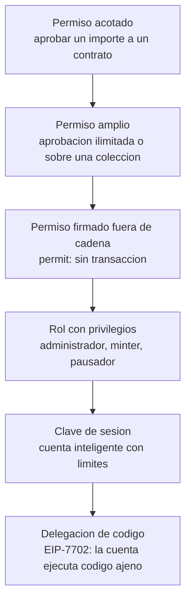

# Bloque 4 · Riesgos de la delegación de permisos

> 🧭 [⬅️ Bloque 3 · Custodia y claves](03-custodia-claves-y-politicas-de-firma.md) · [🛡️ Especialización](../README.md) · ➡️ [Bloque 5 · Trazabilidad multicadena](05-trazabilidad-multicadena.md) · [📖 Glosario](../glosario.md)

**Nivel:** avanzado · **Duración:** 4–5 h · **Prerrequisitos:** bloques 1 a 3, [clases 17–18](../../curriculum/08-tokens/README.md) y [clases 19–20](../../curriculum/09-seguridad/README.md) · **Laboratorios:** [LE4](../laboratorios/LE4-delegacion-eip7702.md) y [LE5](../laboratorios/LE5-detector-delegaciones.md) · **Amplía:** [unidad de seguridad](../../curriculum/09-seguridad/README.md), [unidad de tokens](../../curriculum/08-tokens/README.md)

## Punto de partida

**Pregunta guía:** cuando concedes un permiso, ¿qué le has entregado exactamente: una acción, una cantidad, un periodo o el control total de la cuenta?

Delegar es necesario: sin permisos no hay exchanges descentralizados, ni suscripciones, ni cuentas patrocinadas. Y delegar es también el patrón de ataque más repetido de la última década: en casi todos los casos, la víctima concedió algo **válido** que le dio al atacante más poder del que creía. Este bloque ordena los tipos de delegación por **cuánto poder ceden**.

## Una escala del poder delegado

Cada escalón añade poder y, casi siempre, reduce la visibilidad.

| Delegación | Qué cede | Límite natural | Revocación | Visibilidad |
|---|---|---|---|---|
| `approve` ERC-20 | Mover hasta `X` unidades de un token | El importe aprobado | `approve(…, 0)` | Evento `Approval` |
| `approve` ilimitado | Mover **todo** el saldo del token, hoy y mañana | Ninguno | `approve(…, 0)` | Evento `Approval` |
| `setApprovalForAll` (ERC-721/1155) | Mover **cualquier** NFT de la colección | Ninguno | `setApprovalForAll(…, false)` | Evento `ApprovalForAll` |
| `permit` ([EIP-2612](https://eips.ethereum.org/EIPS/eip-2612)) | Una aprobación **firmada fuera de cadena** | Importe y caducidad firmados | Gastar el nonce del permit | **Ninguna hasta que se usa** |
| Rol de contrato | Funciones privilegiadas | El código | Revocar el rol | Evento de rol |
| Clave de sesión | Operar con límites en una cuenta inteligente | Los que programe la cuenta | Revocar la clave | Depende de la cuenta |
| **Delegación EIP-7702** | **Todo el comportamiento de la cuenta** | **El que imponga el código delegado, ninguno si es hostil** | Firmar una delegación a la dirección cero | **Cambio de código; no hay evento** |

La última fila cambia la lista. Un `approve` cede una capacidad concreta sobre un activo; una delegación de código cede la cuenta entera, incluidos activos que aún no han llegado.

## Los cinco rasgos que hacen peligrosa una delegación

1. **Amplitud.** ¿Cede una acción o una identidad completa?
2. **Persistencia.** ¿Caduca, o sigue activa hasta que alguien actúe? Una delegación EIP-7702 no caduca.
3. **Invisibilidad.** ¿Deja evento o rastro inmediato? Un `permit` no deja nada hasta que se usa; una delegación EIP-7702 solo deja un cambio de código y un salto de nonce.
4. **Transferibilidad.** ¿La firma puede viajar? Las autorizaciones son firmas sueltas que cualquiera puede publicar.
5. **Reproducibilidad entre redes.** ¿Vale en una cadena o en todas? Una autorización con `chain_id = 0` vale en todas.

La mayoría de los incidentes reúne tres o más.

## EIP-7702 como delegación: lo que añade al problema

El [bloque 2](02-cuentas-contratos-y-abstraccion.md) explica el mecanismo. Aquí interesa su **superficie de riesgo**:

| Riesgo | Cómo ocurre | Qué lo contiene |
|---|---|---|
| **Delegado hostil** | La víctima firma una autorización hacia un contrato que obedece a un tercero | Mostrar con claridad qué código se adopta; lista de delegados aprobados |
| **Ventana de nonces** | Quien posee la clave firma muchas autorizaciones para acertar con el nonce vigente | Detección de múltiples firmas de una cuenta en una transacción |
| **Firma `chain_id = 0`** | Una firma robada se reutiliza en cada red | Rechazar `chain_id = 0` salvo delegados aprobados |
| **Persistencia** | Cada fondo posterior queda al alcance | Revocación activa y detección de delegaciones vigentes |
| **Inicialización adelantada** | Un tercero inicializa el delegado antes que el dueño | Exigir que la inicialización esté firmada por la clave |
| **Colisión de almacenamiento** | Al cambiar de delegado, el nuevo reinterpreta el estado del anterior | Diseños de almacenamiento a prueba de colisión |
| **Patrocinio hostil** | El dueño deja sin pagar al patrocinador | Fianzas o reputación del patrocinador |
| **Suposiciones rotas** | Un contrato asume que `tx.origin` o `extcodesize` identifican a una persona | Dejar de basar decisiones en esas señales |

### Un delegado seguro, en una frase

> *Un delegado seguro solo obedece a la propia cuenta, o a instrucciones firmadas por ella ligadas a cadena, cuenta, nonce interno y contenido.*

[LE4](../laboratorios/LE4-delegacion-eip7702.md) implementa ambas variantes (`LoteSeguro` y `PatrocinioFirmado`) y las contrasta con un delegado hostil simulado que obedece a un "operador". La diferencia entre los tres es **una sola línea de control de acceso**.

## Lista de comprobación para revisar un delegado

Antes de aprobar un contrato como delegado, responde por escrito:

1. ¿Quién puede ordenarle ejecutar algo? ¿Solo la propia cuenta, o terceros con una firma?
2. ¿Cada instrucción firmada incluye cadena, cuenta y un nonce propio?
3. ¿Hay alguna función de barrido, reenvío de llamadas arbitrarias o ejecución delegada?
4. ¿La inicialización exige la firma de la clave de la cuenta?
5. ¿El almacenamiento usa un diseño a prueba de colisión?
6. ¿El contrato es actualizable? ¿Quién puede cambiarlo?
7. ¿Hay reentrada posible durante las llamadas que hace en nombre de la cuenta?
8. ¿Cómo se revoca y cuánto cuesta hacerlo?
9. ¿El código está **verificado** y revisado por alguien distinto del autor?
10. ¿Cuánto tiempo lleva desplegado y qué historial de uso tiene? (La edad no condena, pero un contrato de horas pide más escrutinio.)

## Controles por rol

### Para un usuario

- Trata cada solicitud de **firma que no sea una transferencia** como una concesión de poder y pregúntate qué cede, hasta cuándo y para qué.
- Revisa y revoca permisos periódicamente.
- Separa una cuenta de uso diario de la que guarda valor.
- Desconfía de cualquier sitio que te pida firmar una autorización para "actualizar" tu wallet.

### Para una aplicación o wallet

- Decodificar y **mostrar** lo que se firma en términos humanos: cantidad, destino, caducidad.
- Nunca tratar una autorización de delegación como una firma rutinaria.
- Simular el efecto antes de pedir la firma ([prevuelo de una transacción](../../labs/00-wallets/prevuelo-transaccion.mjs)).

### Para un custodio

1. **Inventario.** Qué permisos y delegaciones están activos en cada cuenta gestionada.
2. **Prohibir por defecto.** Que las claves de billetera caliente no firmen autorizaciones fuera de un procedimiento aprobado ([bloque 3](03-custodia-claves-y-politicas-de-firma.md)).
3. **Detectar.** Código nuevo en una cuenta gestionada, salto de nonce sin transacción propia, eventos `Approval` hacia contratos no aprobados ([LE5](../laboratorios/LE5-detector-delegaciones.md)).
4. **Revocar.** Tener ensayado cómo y quién revoca, incluida la delegación de código.
5. **Rotar con revocación.** Al cambiar una clave, revocar lo concedido por la anterior.

## Un detector explicable

[LE5](../laboratorios/LE5-detector-delegaciones.md) construye un detector con reglas que suman puntaje y dejan evidencia. Dos lecciones de su evaluación:

- **Una delegación no es un ataque.** Una regla única como "toda delegación" es inservible. Se combinan rasgos: delegado no aprobado, delegado reciente, remitente desconocido y recién fondeado, ventana de autorizaciones, barrido posterior.
- **El puntaje solo no siempre separa.** Con los datos del laboratorio, una dApp legítima y nueva puntúa **más** que una delegación maliciosa de baja intensidad. Ningún umbral los distingue. Lo que sí: confirmación del titular por un canal independiente. La conclusión de diseño es que un detector produce **cola de revisión**, no veredictos.

## Errores frecuentes

- **Considerar "approve" y "delegar el código" como el mismo riesgo.** El segundo cede la cuenta.
- **Creer que una firma que no mueve fondos es inofensiva.** Un `permit` o una autorización no mueven nada hasta que se usan.
- **Revocar el permiso y olvidar el que se firmó fuera de cadena y aún no se gastó.**
- **Dar por segura una delegación porque el delegado "está verificado".** Verificado no es lo mismo que seguro.
- **Esperar un evento.** La delegación de código no emite ninguno; hay que mirar el código de la cuenta.

## Comprobación

1. Ordena de menor a mayor poder cedido: `permit`, `approve` acotado, delegación EIP-7702, `setApprovalForAll`.
2. ¿Por qué un `permit` es más difícil de detectar que un `approve`?
3. ¿Qué cinco rasgos hacen peligrosa una delegación?
4. ¿Qué diferencia en el control de acceso separa un delegado seguro de uno hostil?
5. Un detector marca igual una dApp nueva legítima y una delegación maliciosa discreta. ¿Qué información externa los separa?

**Respuestas orientadoras.** (1) `approve` acotado, `permit`, `setApprovalForAll`, delegación EIP-7702; (2) no deja evento hasta que se gasta; (3) amplitud, persistencia, invisibilidad, transferibilidad, reproducibilidad entre redes; (4) quién puede ordenarle ejecutar algo; (5) la confirmación del titular por un canal independiente.

## Fuentes

- [EIP-7702](https://eips.ethereum.org/EIPS/eip-7702) · [EIP-2612 · permit](https://eips.ethereum.org/EIPS/eip-2612) · [EIP-20](https://eips.ethereum.org/EIPS/eip-20)
- [Ethereum.org · seguridad de contratos](https://ethereum.org/developers/docs/smart-contracts/security/)
- [Ethereum.org · EIP-7702 en Pectra](https://ethereum.org/roadmap/pectra/7702/)

## ✅ Criterio de dominio

Puedes ordenar una lista de permisos por el poder que ceden, revisar un delegado con la lista de diez preguntas y diseñar un inventario y una detección de delegaciones para una custodia.

## 🧭 Navegación

⬅️ [Bloque 3 · Custodia y claves](03-custodia-claves-y-politicas-de-firma.md) · [🛡️ Especialización](../README.md) · ➡️ [Bloque 5 · Trazabilidad multicadena](05-trazabilidad-multicadena.md) · [🧪 LE4](../laboratorios/LE4-delegacion-eip7702.md) · [🧪 LE5](../laboratorios/LE5-detector-delegaciones.md) · [🏠 Programa](../../README.md)
