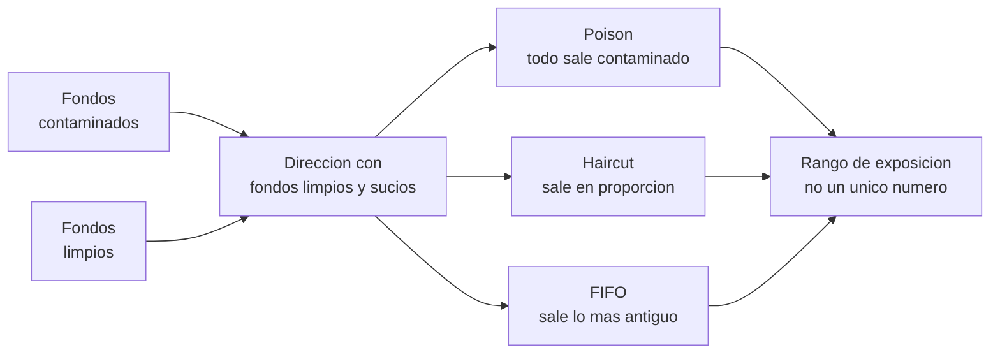

# Bloque 5 · Rastreabilidad de activos en Ethereum, Bitcoin, Tron y redes L2

> 🧭 [⬅️ Bloque 4 · Delegación de permisos](04-delegacion-de-permisos.md) · [🛡️ Especialización](../README.md) · ➡️ [Bloque 6 · Stablecoins y congelamiento](06-stablecoins-congelamiento-y-recuperacion.md) · [📖 Glosario](../glosario.md)

**Nivel:** avanzado · **Duración:** 5–6 h · **Prerrequisitos:** bloques 1 a 4, [clases 57–58](../../curriculum/28-data-analytics-onchain/README.md) y [clases 65–66](../../curriculum/32-forensics-auditoria-gobernanza/README.md) · **Laboratorios:** [LE6](../laboratorios/LE6-explorador-transacciones.md) y [LE7](../laboratorios/LE7-flujos-multidireccion.md) · **Amplía:** [unidad de analítica on-chain](../../curriculum/28-data-analytics-onchain/README.md), [unidad de forensics](../../curriculum/32-forensics-auditoria-gobernanza/README.md)

## Punto de partida

**Pregunta guía:** si todo está en un registro público, ¿por qué seguir el rastro de unos fondos es difícil, y cuánto de lo que se concluye es hecho y cuánto convención?

Un registro público no es un registro **interpretable**. Los datos están, pero responder "¿a dónde fue el dinero?" exige decisiones de modelo —qué es una cuenta, qué es una entidad, cómo se mezclan fondos limpios y sucios— que la cadena no toma por ti. Este bloque separa lo que la cadena **afirma** de lo que tú **infieres**.

## Cuatro modelos de datos, cuatro formas de seguir fondos

| Cadena | Modelo | Unidad de análisis | Qué dificulta el rastreo |
|---|---|---|---|
| **Bitcoin** | UTXO | Entradas y salidas de una transacción | No hay saldo por dirección ni "cuenta": hay que reconstruir qué entrada financió qué salida |
| **Ethereum** | Cuentas y contratos | Transacciones, llamadas internas, eventos | Los movimientos de ETH dentro de contratos **no emiten evento**; los eventos de token los emite el contrato y pueden falsificarse |
| **Tron** | Cuentas con recursos (energía y ancho de banda) | Transacciones y transferencias de TRC-20 | Predomina USDT en TRC-20; las direcciones intermedias son baratas y numerosas |
| **L2 (rollups)** | Cadena propia con anclaje en L1 | Transacciones L2, lotes publicados en L1, puentes | El mismo patrón de dirección existe en varias redes; el dinero cruza por puentes |

### Bitcoin: UTXO

- Una transacción consume salidas anteriores y crea nuevas. No existe "A envía a B": existen **entradas** y **salidas** agrupadas.
- **Heurística de entradas comunes.** Si varias entradas se firman en una misma transacción, suele inferirse que las controla la misma entidad. Es útil y **falla** ante *coinjoins* y otras construcciones colaborativas.
- **Dirección de cambio.** La salida que "vuelve" al remitente se identifica por patrones (importes, tipo de dirección). También es una inferencia.
- **Cadena de pelado (peel chain).** El grueso avanza a una nueva dirección y una porción menor sale en cada paso. [LE7](../laboratorios/LE7-flujos-multidireccion.md) la detecta como **indicador**, no como prueba.

### Ethereum: cuentas, trazas y eventos

- Un **evento `Transfer`** registra un movimiento de token solo porque *ese contrato* decidió emitirlo. Cualquier contrato puede emitir un `Transfer` falso. Antes de fiarte de un evento, **verifica el contrato emisor y contrasta con los saldos**.
- El **ETH** movido por un contrato o por una cuenta delegada **no deja evento**. Hace falta la *traza de llamadas* (`call traces`) o reconstruir la contabilidad por saldos.
- Una **cuenta delegada** (EIP-7702) mueve fondos mediante el código del delegado: el rastro está en llamadas internas, no en transacciones salientes de la cuenta.

### Tron

- Modelo de cuentas con **recursos**: las operaciones consumen energía y ancho de banda, o TRX quemado.
- Es la cadena de mayor circulación de USDT en el caso estudiado ([bloque 9](09-caso-binance-2026-10-29.md)). Las rutas de dispersión usan muchas direcciones intermedias.
- **Indicador débil, no prueba:** direcciones cuya primera entrada fue exactamente 1 TRX. Chainalysis lo observó entre las direcciones de lavado del caso. Es una convención de quien prepara las cuentas, y otro actor puede imitarla.

### L2 y puentes

- Los **rollups** ejecutan transacciones en su propia cadena y publican datos en L1. El seguimiento exige mirar ambas capas.
- Un **puente** convierte un activo en la cadena de origen (bloqueo o quema) y lo representa en destino (emisión o liberación). Emparejar la salida con la entrada es una **inferencia** basada en importe, tiempo y, si existe, un identificador.
- Los retiros de rollups optimistas tienen ventana de desafío; hay puentes de liquidez rápida que adelantan fondos.
- **Excepción de gobernanza:** en el caso estudiado, el Consejo de Seguridad de Arbitrum ejecutó transferencias forzadas de fondos de hot wallets de Binance en esa red (TRM). Es un mecanismo propio de una cadena concreta, no una función general de las L2.

## Del movimiento a la conclusión: el problema de la mezcla

Cuando fondos de procedencia distinta se juntan en una dirección, lo que sale **no lleva etiqueta**. Hay que elegir una convención:

| Método | Convención | Sesgo |
|---|---|---|
| **Poison** | Toda salida de una cuenta con algo contaminado es contaminada | Sobrestima: arrastra dinero ajeno |
| **Haircut** | La contaminación sale en proporción a la que hay en el saldo | Intermedio |
| **FIFO** | El primero que entra es el primero que sale | Depende del orden y de una convención contable |

Con los **mismos datos**, [LE7](../laboratorios/LE7-flujos-multidireccion.md) da para una dirección intermedia 150, 111 y 50 unidades de exposición según el método. Ninguno es "la respuesta": un informe responsable da el **rango**, nombra el método y explica el supuesto.

## Los cuatro niveles de certeza

Todo lo que digas sobre un flujo pertenece a uno de estos niveles. Rotúlalo.

| Nivel | Definición | Ejemplo |
|---|---|---|
| **Hecho** | Verificable en el registro | "La transacción `T` movió `X` de `A` a `B`" |
| **Indicador** | Patrón observable que sugiere algo, sin demostrarlo | "Cadena de pelado de 4 pasos" |
| **Inferencia** | Conclusión razonada con supuestos explícitos | "El puente `b1` conecta `A` con `C`" |
| **Hipótesis** | Explicación posible sin confirmación | "Las direcciones intermedias son de la misma entidad" |

> **Regla de oro:** una dirección no es una persona. Una etiqueta ("exchange", "mezclador", "grupo X") es una afirmación de un tercero con fecha y confianza: regístralas así. Toda atribución sin fuente independiente es una hipótesis. Aplica [¿Y si cruzas la línea?](../../docs/y-si-cruzas-la-linea-blockchain.md).

## Procedimiento de rastreo reproducible

1. **Fija el alcance.** Dirección de origen, ventana temporal, activos.
2. **Congela los datos.** Guarda la salida de cada consulta con fecha, nodo y bloque.
3. **Construye el grafo de hechos.** Solo transacciones y transferencias verificables.
4. **Distingue los activos.** No sumes ETH, BTC y stablecoins como si fuesen lo mismo.
5. **Resuelve los saltos entre cadenas** (puentes, intercambios) como inferencias con confianza.
6. **Aplica un método de propagación y calcula el rango** con los tres.
7. **Marca los puntos de acción:** dónde hay un emisor que puede congelar ([bloque 6](06-stablecoins-congelamiento-y-recuperacion.md)) y dónde no.
8. **Escribe el informe** con las cuatro categorías y sin atribución de identidad.

## Privacidad y límites

- **Mezcladores y herramientas de privacidad** rompen el vínculo directo entre entrada y salida. El rastreo pasa a ser probabilístico. Su estatus regulatorio ha cambiado con el tiempo: consulta la fuente oficial vigente y no des por buena una afirmación antigua.
- **Falsas atribuciones.** Una dirección "envenenada" puede enviar polvo a un tercero para que aparezca vinculado a ella. Un vínculo de una sola transferencia pequeña no prueba relación.
- **Datos personales.** Un análisis que identifica a personas necesita base legal y proporcionalidad. En la práctica del programa todo es sintético.
- **Lo que está fuera de la cadena.** Un depósito en un exchange termina el rastro público: lo que ocurra después es contabilidad interna de quien lo custodia.

## Errores frecuentes

- **Presentar un único número de "fondos manchados".** Sin método, no es un dato.
- **Fiarse de un evento sin comprobar el contrato que lo emite.**
- **Seguir solo transacciones salientes** de una cuenta que puede estar delegada.
- **Tratar un emparejamiento de puente como un hecho de cadena.**
- **Confundir proximidad con identidad.** Haber recibido fondos de la misma dirección no prueba relación.

## Comprobación

1. ¿Por qué el ETH movido por un contrato no aparece como evento?
2. ¿Qué diferencia hay entre un indicador y una inferencia? Da un ejemplo de cada uno en este bloque.
3. Tres métodos dan 50, 111 y 150 unidades para la misma dirección. ¿Cómo lo informas?
4. ¿Por qué un emparejamiento de puente es una inferencia?
5. ¿Qué punto del rastreo deja de ser visible al llegar a un depósito de exchange?

**Respuestas orientadoras.** (1) La transferencia de ETH no es un evento de contrato; hace falta la traza interna o reconstruir por saldos; (2) un indicador es un patrón observable (cadena de pelado), una inferencia es una conclusión con supuestos (el emparejamiento de un puente); (3) como rango, nombrando el método y su supuesto; (4) se basa en importe, tiempo e identificador, no en un enlace verificable; (5) la contabilidad interna posterior.

## Fuentes

- [Chainalysis · hallazgos sobre el incidente](https://www.chainalysis.com/blog/binance-exploit-latest-findings-and-response/) · [TRM · cronología multicadena](https://www.trmlabs.com/resources/blog/north-korea-steals-usd-6-36-billion-from-binance-in-the-largest-hack-in-history)
- [NIST SP 800-86 · técnicas forenses en la respuesta a incidentes](https://csrc.nist.gov/pubs/sp/800/86/final)
- [Ethereum.org · JSON-RPC](https://ethereum.org/en/developers/docs/apis/json-rpc/) · [Bitcoin Developer · transacciones](https://developer.bitcoin.org/devguide/transactions.html)

## ✅ Criterio de dominio

Puedes seguir fondos entre cadenas, etiquetar cada paso como hecho, indicador, inferencia o hipótesis, y presentar la exposición como un rango con su método, sin atribuir identidad.

## 🧭 Navegación

⬅️ [Bloque 4 · Delegación de permisos](04-delegacion-de-permisos.md) · [🛡️ Especialización](../README.md) · ➡️ [Bloque 6 · Stablecoins y congelamiento](06-stablecoins-congelamiento-y-recuperacion.md) · [🧪 LE6](../laboratorios/LE6-explorador-transacciones.md) · [🧪 LE7](../laboratorios/LE7-flujos-multidireccion.md) · [🏠 Programa](../../README.md)
