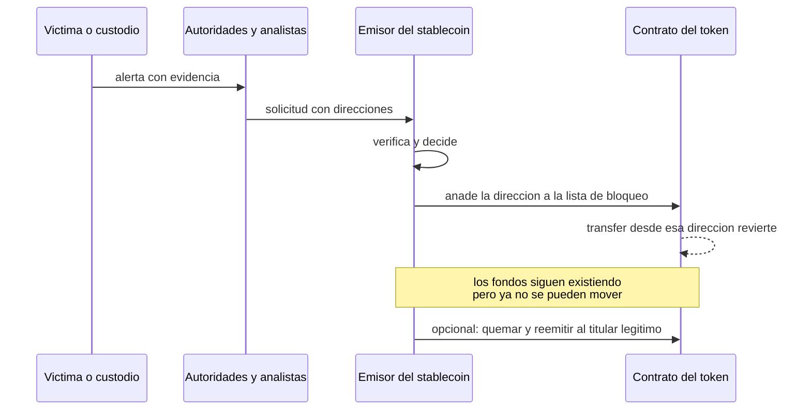
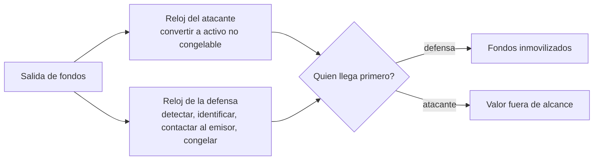

# Bloque 6 · Stablecoins, congelamientos y límites de la recuperación

> 🧭 [⬅️ Bloque 5 · Trazabilidad multicadena](05-trazabilidad-multicadena.md) · [🛡️ Especialización](../README.md) · ➡️ [Bloque 7 · Transacciones, eventos y logs](07-analisis-de-transacciones-eventos-y-logs.md) · [📖 Glosario](../glosario.md)

**Nivel:** avanzado · **Duración:** 3–4 h · **Prerrequisitos:** bloque 5 y [clases 43–44](../../curriculum/21-stablecoins/README.md) · **Laboratorio:** [LE7](../laboratorios/LE7-flujos-multidireccion.md) (análisis de recuperabilidad) · **Amplía:** [unidad de stablecoins](../../curriculum/21-stablecoins/README.md), [unidad de forensics](../../curriculum/32-forensics-auditoria-gobernanza/README.md)

## Punto de partida

**Pregunta guía:** si un emisor puede congelar una dirección, ¿por qué un robo de miles de millones sigue siendo en gran parte irrecuperable?

Porque el congelamiento es un **control posterior, selectivo y con reloj**. Solo actúa donde existe un emisor con una función de bloqueo, solo mientras el valor siga en esa forma y en esa dirección, y solo si alguien lo pide a tiempo. En el caso estudiado ([bloque 9](09-caso-binance-2026-10-29.md)) se congelaron del orden de 2 500 a 3 000 millones de USD de unos 6 300 millones: mucho en términos absolutos, y a la vez menos de la mitad.

## Qué activos se pueden congelar

| Activo | ¿Hay un emisor central? | ¿Función de bloqueo? | Quién decide |
|---|---|---|---|
| Stablecoin respaldada por reservas (por ejemplo USDT, USDC, RLUSD, USD1) | Sí | Habitualmente sí, mediante una lista de bloqueo en el contrato | El emisor, a menudo con orden legal o petición de autoridades |
| Stablecoin descentralizada (colateralizada en cadena) | No | Depende de su gobernanza | Votación o parámetros del protocolo |
| ETH, BTC, XRP, SOL, TRX | No | **No existe** | Nadie puede bloquear una dirección por protocolo |
| Token envuelto o representación en puente | Depende | Depende del contrato y del custodio del subyacente | Emisor del token y custodio del respaldo |
| Posición en un protocolo DeFi | No | Puede haber pausa de mercado | Gobernanza del protocolo |

Esto fija la primera regla de recuperación: **lo que se convierte a un activo sin emisor sale del alcance de cualquier congelamiento.** En el caso, unos 325 millones de USDT se vendieron por ETH a un precio con prima y se tomaron préstamos contra stablecoins ([TRM](https://www.trmlabs.com/resources/blog/north-korea-steals-usd-6-36-billion-from-binance-in-the-largest-hack-in-history)); a partir de ahí, ese valor ya no es congelable por quien emite el stablecoin.

## Cómo funciona un congelamiento

Detalles que se pierden con frecuencia:

- **Congelar no es devolver.** El fondo queda inmovilizado en la dirección. Devolverlo requiere una decisión adicional del emisor, que puede **quemar** los tokens bloqueados y **reemitir** el mismo importe al titular legítimo, normalmente con respaldo judicial o de autoridades ([CNBC](https://www.cnbc.com/2026/10/30/binance-hack-stolen-crypto-recovery.html)).
- **Solo congela lo que sigue ahí.** Si el atacante movió el valor antes de la orden, el bloqueo de la dirección anterior no sirve. Un congelamiento puede ser parcial: inmoviliza lo que quedaba en la dirección en el momento de la orden, no lo que pasó por ella antes (el laboratorio LE7 lo reproduce con datos sintéticos).
- **Requiere reconocer la dirección a tiempo.** El primer congelamiento de Tether en el caso llegó a las 21:01 UTC, unos 40 minutos después de la transacción tipo 4 en Ethereum y casi una hora después de las primeras salidas en XRP Ledger (TRM).
- **Es una decisión humana del emisor.** Tiene criterio, fricción y riesgo de error.

## La carrera

El resultado depende de comparar dos relojes:

Las defensas que acortan el reloj de la defensa son todas **previas** al incidente:

1. **Contactos 24/7 con los emisores** y un procedimiento acordado, no un formulario improvisado.
2. **Lista de direcciones lista para enviar**, con evidencia mínima suficiente y formato que el emisor acepte.
3. **Detección rápida**: cada minuto de retraso se traduce en valor convertido ([LE8](../laboratorios/LE8-monitor-riesgos-custodio.md)).
4. **Coordinación con autoridades** y con otras entidades del ecosistema (intercambios, protocolos, analistas).

## Lo que el congelamiento no soluciona

- **Activos sin emisor.** ETH, BTC y similares.
- **Valor ya convertido, prestado o enviado a otra cadena.**
- **Valor en protocolos DeFi.** Se pueden pausar mercados, pero no todos los protocolos tienen esa capacidad.
- **Valor tras un intercambio centralizado**: lo que ocurra dentro es contabilidad privada. Los investigadores señalan que, tras pasar por redes de blanqueo, la conversión a efectivo se dificulta aún más (CNBC).
- **Jurisdicciones y plazos.** La restitución judicial es lenta.

### El riesgo del congelamiento erróneo

Una lista de bloqueo es un poder de intervención. Un error afecta a un tercero inocente: fondos legítimos inmovilizados. Un diseño responsable incluye verificación mínima, un camino de **apelación** y un registro de decisiones. Para el custodio que las solicita: aportar evidencia cierta, no sospechas.

## Para el custodio: diseñar sabiendo esto

1. **Trata el congelamiento como control compensatorio, no preventivo.** No sustituye al tope de saldo ni a la política de firma.
2. **Conoce qué porcentaje de tu hot es congelable.** Una hot compuesta de stablecoins con emisor tiene más probabilidad de contención que una de ETH.
3. **Mide el tiempo de respuesta** de punta a punta en simulacros, no en teoría.
4. **Ten claro el orden de las acciones**: contener la fuente (parar el sangrado), congelar lo que se pueda, comunicar.
5. **No prometas recuperación.** Tras un incidente, las cifras de congelado cambian durante horas; la restitución efectiva se mide en semanas o meses.

## Análisis de recuperabilidad en LE7

[LE7](../laboratorios/LE7-flujos-multidireccion.md) clasifica cada saldo contaminado en tres grupos que **suman el total**:

| Grupo | Significado | Acción |
|---|---|---|
| Ya congelado | Inmovilizado por un emisor | Iniciar la restitución |
| Congelable pendiente | Es un stablecoin con emisor y sigue en una dirección | Solicitar el bloqueo ya |
| No congelable | ETH, BTC, XRP, SOL, TRX o sin emisor | Depende de quien controle la salida (exchanges, mesas OTC) |

Con los datos sintéticos, más de la mitad del valor está en el tercer grupo. Es la forma de la pérdida real: la defensa gana en lo congelable y pierde en el resto.

## Errores frecuentes

- **Decir "congelado" cuando se quiere decir "recuperado".**
- **Sumar el congelado de fuentes con horas de corte distintas** y presentar el total como una sola cifra.
- **Creer que un emisor puede actuar sobre cualquier activo.**
- **Esperar al cierre de la investigación para pedir el bloqueo.** El reloj corre desde el primer movimiento.
- **Pedir el bloqueo de una dirección por sospecha, no por evidencia.**

## Comprobación

1. ¿Por qué ETH no se puede congelar a nivel de protocolo?
2. ¿Qué diferencia hay entre congelar y restituir?
3. Una dirección con 175 millones recibe un bloqueo de 100. ¿Qué ocurrió con los otros 75 y qué debe hacerse?
4. ¿Qué acciones previas al incidente acortan el reloj de la defensa?
5. ¿Por qué un error de congelamiento es un riesgo y cómo se mitiga?

**Respuestas orientadoras.** (1) No hay emisor ni función de bloqueo; (2) congelar inmoviliza, restituir requiere quemar y reemitir con respaldo; (3) siguen movibles o ya se movieron, y debe solicitarse el resto de inmediato; (4) contactos 24/7, lista de direcciones preparada, detección rápida, coordinación; (5) inmoviliza fondos legítimos, se mitiga con verificación, apelación y registro.

## Fuentes

- [TRM · cronología y congelamientos](https://www.trmlabs.com/resources/blog/north-korea-steals-usd-6-36-billion-from-binance-in-the-largest-hack-in-history) · [CNBC · recuperación](https://www.cnbc.com/2026/10/30/binance-hack-stolen-crypto-recovery.html) · [Chainalysis](https://www.chainalysis.com/blog/binance-exploit-latest-findings-and-response/)
- [Transparencia de Tether](https://tether.to/en/transparency/) · [Transparencia de Circle](https://www.circle.com/transparency)
- [Caso Terra/UST](../../docs/casos-reales/terra-ust.md)

## ✅ Criterio de dominio

Puedes decir, para cada activo de un robo, si es congelable y quién decide; estimar qué parte del valor está en cada grupo; y diseñar los preparativos que acortan el reloj de la defensa.

## 🧭 Navegación

⬅️ [Bloque 5 · Trazabilidad multicadena](05-trazabilidad-multicadena.md) · [🛡️ Especialización](../README.md) · ➡️ [Bloque 7 · Transacciones, eventos y logs](07-analisis-de-transacciones-eventos-y-logs.md) · [🧪 LE7](../laboratorios/LE7-flujos-multidireccion.md) · [🏠 Programa](../../README.md)
