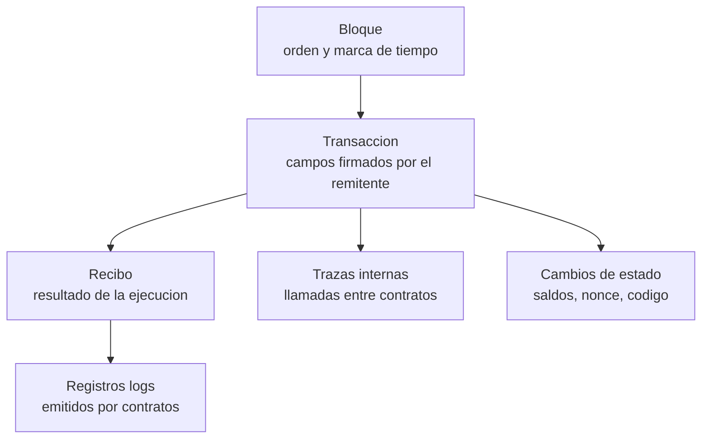

# Bloque 7 · Análisis de transacciones, eventos y logs on-chain

> 🧭 [⬅️ Bloque 6 · Stablecoins y congelamiento](06-stablecoins-congelamiento-y-recuperacion.md) · [🛡️ Especialización](../README.md) · ➡️ [Bloque 8 · Pruebas de reservas](08-pruebas-de-reservas-y-sus-limites.md) · [📖 Glosario](../glosario.md)

**Nivel:** avanzado · **Duración:** 4–5 h · **Prerrequisitos:** bloques 2 y 5, [clases 11–12](../../curriculum/05-ethereum-evm/README.md) y [clases 57–58](../../curriculum/28-data-analytics-onchain/README.md) · **Laboratorios:** [LE6](../laboratorios/LE6-explorador-transacciones.md) y [LE3](../laboratorios/LE3-transferencias-simuladas.md) · **Amplía:** [unidad de analítica on-chain](../../curriculum/28-data-analytics-onchain/README.md), [unidad de EVM](../../curriculum/05-ethereum-evm/README.md)

## Punto de partida

**Pregunta guía:** ¿cómo reconstruyo, sin confiar en el explorador de nadie, qué ocurrió en una transacción?

Un explorador de bloques es una interfaz sobre un nodo. Cuando algo se investiga en serio, la interfaz oculta justo lo que importa: qué campos se decodificaron, de dónde sale la etiqueta "Binance 14", si una autorización se aplicó o solo se firmó. Este bloque enseña a **leer la transacción desde el nodo** y a distinguir lo que el registro garantiza de lo que un contrato afirma por su cuenta.

## Anatomía de la evidencia de una transacción en Ethereum



| Fuente | Qué contiene | Qué **no** contiene |
|---|---|---|
| **Transacción** (`eth_getTransactionByHash`) | Remitente (recuperado de la firma), destino, valor, datos, nonce, tipo, y en tipo 4 la lista de autorizaciones | Si cada autorización **se aplicó** |
| **Recibo** (`eth_getTransactionReceipt`) | Estado (éxito o reversión), gas usado, registros | Los movimientos de ETH entre contratos |
| **Registros** (`eth_getLogs`) | Eventos que un contrato decidió emitir | Nada que el contrato no haya emitido; pueden ser falsos |
| **Trazas** (`debug_traceTransaction` y similares) | Llamadas internas y ETH movido por contratos | Disponibilidad garantizada: no todos los nodos las sirven |
| **Estado** (`eth_getCode`, `eth_getBalance`, `eth_getTransactionCount`) | La foto actual de una cuenta | Cómo llegó a ese estado |

### Un registro (log) por dentro

Un evento ERC-20 `Transfer(address indexed from, address indexed to, uint256 value)` se almacena así:

```text
address  = dirección del contrato que lo emitió
topics[0] = keccak256("Transfer(address,address,uint256)")
            = 0xddf252ad1be2c89b69c2b068fc378daa952ba7f163c4a11628f55a4df523b3ef
topics[1] = from  (relleno a 32 bytes)
topics[2] = to    (relleno a 32 bytes)
data      = value (32 bytes)
```

Los argumentos `indexed` van a los *topics* (se pueden filtrar eficientemente con `eth_getLogs`); los demás, a `data`. El `topics[0]` es el **hash de la firma del evento**, el mismo cálculo que el selector de una función ([bloque 1](01-criptografia-asimetrica-y-firmas.md)). [LE6](../laboratorios/LE6-explorador-transacciones.md) decodifica estos registros con su propio Keccak-256.

### La trampa de los eventos

> **Un evento prueba que un contrato lo emitió, no que ocurrió lo que dice.**

- Cualquier contrato puede emitir un `Transfer` con los valores que quiera, sin mover ningún saldo.
- Un token malicioso puede emitir `Transfer` desde una dirección que nunca tuvo ese saldo.
- La verificación correcta combina tres cosas: **(1)** el contrato emisor es el token esperado; **(2)** el evento es coherente con la variación del saldo (`balanceOf` antes y después); **(3)** no hay una ruta alternativa que explique el saldo.

### Lo que los eventos no ven

- **ETH movido por contratos y por cuentas delegadas.** Se ve en trazas o por diferencia de saldos.
- **Cambio de código de una cuenta (EIP-7702).** No emite evento. Se detecta leyendo `eth_getCode` y observando que el nonce avanzó sin transacción propia.
- **Autorizaciones no aplicadas.** Una tupla inválida deja rastro solo en la transacción, no en el estado.

## Transacciones tipo 4: cómo se leen

Una transacción EIP-7702 se analiza con cinco preguntas:

1. **¿Quién es el remitente y quién es cada autoridad?** El remitente se recupera de la firma de la transacción; cada autoridad, de la firma **de su autorización** (`0x05 ‖ rlp([chain_id, address, nonce])`). Casi nunca coinciden en un ataque.
2. **¿A qué contrato delega cada tupla?** La dirección `address`. Comprueba su edad, su código y si está verificado.
3. **¿Qué `chain_id` lleva cada tupla?** El valor `0` significa "cualquier cadena".
4. **¿Cuántas tuplas por autoridad y con qué nonces?** Varias de una misma cuenta con nonces consecutivos son una **ventana**.
5. **¿Surtió efecto?** El RPC básico no lo dice. Se contrasta con el código **actual** de la cuenta (`0xef0100` + el delegado esperado) y con el salto de su nonce.

[LE6](../laboratorios/LE6-explorador-transacciones.md) automatiza estas cinco preguntas y emite advertencias cuando detecta que la autoridad no es el remitente, que hay varias tuplas de la misma cuenta o que `chain_id` es 0.

## Bitcoin: los mismos principios con otro modelo

- **Identificadores.** El `txid` no incluye los datos de testigo; el `wtxid` sí. Para detectar maleabilidad o para referenciar con exactitud, importa cuál usas.
- **Lectura.** `getrawtransaction` devuelve entradas (referencias a salidas anteriores) y salidas (importe y script). El saldo de una dirección se **reconstruye** sumando las salidas sin gastar.
- **Confirmación.** Una transacción en el mempool no es definitiva; la profundidad de confirmaciones es una medida de probabilidad.
- El [laboratorio de Bitcoin con regtest](../../labs/04-bitcoin-regtest/README.md) permite reproducirlo en local.

## De la consulta al dato fiable

Un análisis serio es un proceso con pasos que se pueden repetir:

1. **Extraer** con una consulta registrada (nodo, bloque, hora).
2. **Normalizar**: tipos, unidades (wei, satoshi, decimales del token), direcciones en un formato único.
3. **Almacenar** de forma idempotente: repetir el proceso no duplica filas.
4. **Tratar la finalidad.** En Ethereum conviene distinguir `latest`, `safe` y `finalized`. Un análisis sobre `latest` puede revertirse por una reorganización.
5. **Consultar** y **registrar** el resultado con su procedencia.

Las clases 57–58 lo desarrollan con una cadena sintética; LE6 lo aplica a una cadena de laboratorio y, opcionalmente, a un nodo público.

## Checklist de lectura de una transacción sospechosa

1. ¿Se recuperó el remitente de la firma o se tomó de un campo?
2. ¿Qué tipo de transacción es? Si es tipo 4, aplica las cinco preguntas anteriores.
3. ¿Cuál fue el estado de ejecución? ¿Se revirtió?
4. ¿Qué eventos hay y de qué contratos? ¿Coinciden con los saldos?
5. ¿Hubo ETH movido por contratos? Busca en trazas o por diferencia de saldos.
6. ¿Qué cuentas cambiaron de código, de nonce o de saldo?
7. ¿Qué había antes y después en el bloque anterior y el siguiente?
8. ¿Cuándo se desplegaron los contratos implicados y quién los desplegó?
9. ¿Qué etiquetas existen para las direcciones y de qué fuente, fecha y confianza son?
10. ¿Qué parte de la conclusión es hecho, indicador, inferencia o hipótesis?

## Errores frecuentes

- **Fiarse del campo "from" de un explorador** sin entender que se recupera de la firma.
- **Dar por hecho un evento `Transfer`** sin comprobar el contrato ni los saldos.
- **Omitir las transacciones tipo 4** al calcular "qué hizo esta cuenta".
- **Mezclar unidades** (wei y ETH, o tokens con decimales distintos).
- **Analizar `latest` como si fuese definitivo.**
- **Copiar un hash o dirección de un artículo** sin comprobarlo en el nodo.

## Comprobación

1. ¿Qué dos cosas debes comprobar antes de fiarte de un evento `Transfer`?
2. Una cuenta cambió su código y no emitió ningún evento. ¿Cómo lo detectas?
3. ¿Qué cinco preguntas haces ante una transacción tipo 4?
4. ¿Por qué el RPC no basta para saber si una autorización se aplicó y cómo lo resuelves?
5. ¿Por qué distinguir `latest` de `finalized`?

**Respuestas orientadoras.** (1) El contrato emisor y la coherencia con la variación de saldos; (2) leyendo `eth_getCode` y el salto de nonce; (3) remitente y autoridades, delegado, `chain_id`, número y nonces por autoridad, y efecto vigente; (4) porque solo informa de la lista y no de su procesamiento, y se contrasta con el código actual; (5) porque `latest` puede revertirse por una reorganización.

## Fuentes

- [Ethereum.org · API JSON-RPC](https://ethereum.org/en/developers/docs/apis/json-rpc/) · [Ethereum.org · bloques](https://ethereum.org/en/developers/docs/blocks/)
- [EIP-7702](https://eips.ethereum.org/EIPS/eip-7702) · [EIP-20 · tokens](https://eips.ethereum.org/EIPS/eip-20)
- [NIST SP 800-86](https://csrc.nist.gov/pubs/sp/800/86/final) · [Bitcoin Developer · transacciones](https://developer.bitcoin.org/devguide/transactions.html)

## ✅ Criterio de dominio

Puedes reconstruir desde un nodo qué hizo una transacción tipo 4, decodificar los registros que emitió sin confiar en un explorador, y rotular cada conclusión con su nivel de certeza.

## 🧭 Navegación

⬅️ [Bloque 6 · Stablecoins y congelamiento](06-stablecoins-congelamiento-y-recuperacion.md) · [🛡️ Especialización](../README.md) · ➡️ [Bloque 8 · Pruebas de reservas](08-pruebas-de-reservas-y-sus-limites.md) · [🧪 LE6](../laboratorios/LE6-explorador-transacciones.md) · [🏠 Programa](../../README.md)
