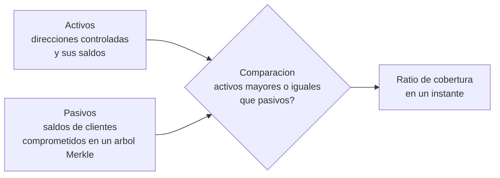

# Bloque 8 · Pruebas de reservas y sus limitaciones

> 🧭 [⬅️ Bloque 7 · Transacciones, eventos y logs](07-analisis-de-transacciones-eventos-y-logs.md) · [🛡️ Especialización](../README.md) · ➡️ [Bloque 9 · Caso Binance](09-caso-binance-2026-10-29.md) · [📖 Glosario](../glosario.md)

**Nivel:** avanzado · **Duración:** 3–4 h · **Prerrequisitos:** bloque 3 y [clases 63–64](../../curriculum/31-proof-reserves-solvencia/README.md) · **Laboratorios:** prácticas 88 y 89 del [catálogo](../../labs/CATALOG.md) (`node labs/31-proof-reserves/por.mjs`) y [LE8](../laboratorios/LE8-monitor-riesgos-custodio.md) · **Amplía:** [unidad de proof of reserves](../../curriculum/31-proof-reserves-solvencia/README.md), [unidad de custodia](../../curriculum/26-custodia-identidad/README.md)

## Punto de partida

**Pregunta guía:** si una entidad publica una prueba de reservas, ¿qué has comprobado y qué sigues sin saber?

Tras un incidente de custodia, la primera pregunta del público es "¿están los fondos de los clientes?". Una prueba de reservas parece la respuesta. Lo es **solo para una parte de la pregunta**, en un instante, bajo supuestos que hay que conocer. Este bloque amplía las clases 63–64 con tres ideas: qué acredita cada componente, cómo se distorsiona una foto, y por qué una prueba de reservas no habría detectado un incidente como el del [bloque 9](09-caso-binance-2026-10-29.md).

## Las dos mitades de una prueba de reservas

### Activos: demostrar control

Se publican direcciones y se demuestra que la entidad **controla** las claves, normalmente con una **firma de desafío** (firmar un mensaje fijado por el verificador) o moviendo una cantidad pequeña. La prueba acredita *control de la clave en ese momento*. No acredita:

- **Titularidad** frente a terceros: la entidad puede custodiar fondos ajenos, o haberlos prestado.
- **Disponibilidad**: la clave puede existir y el activo estar pignorado o bloqueado.
- **Ausencia de gravámenes** o de obligaciones fuera del registro.

### Pasivos: demostrar inclusión

La entidad compromete los saldos de todos sus clientes en un **árbol de Merkle** y publica la raíz. Cada cliente puede verificar que **su saldo** está incluido con una prueba de inclusión. Acredita *que tu saldo está en el conjunto publicado*. No acredita:

- **Que el conjunto esté completo.** Omitir clientes mejora el ratio sin cambiar la raíz verificable por quien sí está incluido.
- **Que los saldos sean los reales** si el cliente no verifica.
- **Pasivos fuera del conjunto**: préstamos recibidos, obligaciones contractuales, litigios.

## Las seis distorsiones de la foto

Una prueba de reservas es una **fotografía**. Las fotografías se pueden preparar.

| Distorsión | Cómo ocurre | Contramedida |
|---|---|---|
| **Maquillaje temporal** | Se toman fondos prestados justo antes del corte y se devuelven después | Pruebas en fechas imprevisibles y frecuentes; revisar movimientos alrededor del corte |
| **Omisión de pasivos** | El árbol deja fuera a clientes o cuentas | Auditoría independiente de la completitud del conjunto |
| **Doble uso de activos** | El mismo activo respalda varias obligaciones | Informes de obligaciones y gravámenes |
| **Activos no equivalentes** | Se suman activos de distinta liquidez como si fueran uno | Cobertura **por activo**, nunca neta entre activos |
| **Valoración** | Un activo ilíquido se valora a un precio optimista | Política de valoración explícita |
| **Alcance** | La prueba cubre una parte de la entidad | Declarar el perímetro |

La regla práctica: **nunca compenses un déficit en un activo con un exceso en otro**. Un faltante de USDC no se cubre con sobrante de BTC para efectos de la promesa al cliente de USDC.

## Qué NO es una prueba de reservas

| Una prueba de reservas **no** es… | Porque |
|---|---|
| Una auditoría financiera | Una auditoría evalúa estados financieros con procedimientos y alcance definidos |
| Una prueba de solvencia | Solvencia exige todo el balance, incluidas obligaciones fuera de la lista |
| Una prueba de **seguridad operativa** | No dice nada sobre cómo se protegen las claves |
| Una garantía de **disponibilidad** | Acredita control, no que se pueda retirar hoy |
| Un sustituto de la regulación | Es una medida complementaria de transparencia |

Las clases 63–64 y el [caso FTX](../../docs/casos-reales/ftx-custodia.md) desarrollan estas diferencias; aquí interesa su consecuencia para la **seguridad operativa**.

## Por qué una prueba de reservas no detecta un incidente de claves

El incidente del [bloque 9](09-caso-binance-2026-10-29.md) ocurrió en minutos. Una prueba de reservas publicada el día anterior mostraba control de claves y una cobertura suficiente, **y todo eso era cierto**. Después del incidente:

- Las **claves seguían siendo controladas por la entidad**, y también por el atacante.
- La **cobertura cambió en minutos**, sin que ninguna prueba periódica lo capturara.
- La **seguridad de las hot wallets**, que determinó la pérdida, no es objeto de la prueba.

La conclusión no es que las pruebas sean inútiles: responden a otra pregunta. Para la seguridad operativa se necesitan controles distintos ([bloque 3](03-custodia-claves-y-politicas-de-firma.md)) y evidencia distinta (informes de controles, pruebas de penetración, simulacros).

## Qué debe publicar una entidad tras un incidente

Con una prueba de reservas **posterior**, la entidad puede aportar hechos que el público puede contrastar. Lo informativo es:

1. **Cobertura por activo** tras el incidente, con la fecha y hora del corte.
2. **Qué parte de la pérdida está absorbida** y por qué mecanismo (fondo de reserva propio, capital, seguro). Una promesa de "cubriremos todas las pérdidas" es una **declaración de capacidad**, no una prueba de ella.
3. **Qué se ha congelado y qué no** ([bloque 6](06-stablecoins-congelamiento-y-recuperacion.md)).
4. **Qué se desconoce** y cuándo se informará.

Cuando un comunicado afirma que los fondos de los usuarios están a salvo, la lectura rigurosa es: *¿qué evidencia lo respalda y qué parte de esa evidencia la puede verificar un tercero?* Con el material público disponible a la fecha del caso, la capacidad de absorción de la entidad es un **desconocido** (U11 en el [bloque 9](09-caso-binance-2026-10-29.md)).

## Prácticas de este bloque

1. **Ejecuta** `node labs/31-proof-reserves/por.mjs` y registra la raíz, los pasivos, los activos y el ratio. Verifica la inclusión de un cliente.
2. **Altera** una copia del conjunto de pasivos (omite un cliente) y comprueba qué ocurre con la raíz y con el ratio. Explica por qué quien sigue incluido no lo detecta.
3. **Construye** un déficit en un solo activo y comprueba que el ratio agregado puede seguir siendo mayor que uno. Reescribe la conclusión **por activo**.
4. **Relaciona** la prueba con el monitor de [LE8](../laboratorios/LE8-monitor-riesgos-custodio.md): ¿qué evento de la línea de tiempo del incidente cambiaría la cobertura y cuánto tiempo pasa hasta la siguiente prueba?

### Solución orientadora

- Omitir un cliente cambia la raíz **y** deja intactas las pruebas de los demás clientes: cada uno sigue verificando su propia inclusión. La completitud no la ve ninguno de ellos.
- Un déficit en USDC con un exceso en BTC puede dejar `activos ≥ pasivos` agregado y, aun así, incumplir la promesa de USDC a los clientes de USDC.
- La pérdida del incidente ocurre en minutos; la siguiente prueba llega en días o semanas: la prueba no es un control de detección.

## Errores frecuentes

- **Interpretar la raíz de Merkle como auditoría.**
- **Sumar activos distintos** para obtener un ratio único.
- **Creer que "control de claves" implica "claves a salvo".**
- **Leer una promesa de cobertura como si fuera evidencia de cobertura.**
- **Olvidar el perímetro:** la prueba cubre lo que declara cubrir.

## Comprobación

1. ¿Qué acredita la firma de desafío y qué no?
2. ¿Por qué un cliente incluido en el árbol no puede detectar que se omitió a otro?
3. ¿Por qué la cobertura debe calcularse por activo?
4. ¿Por qué una prueba de reservas no habría detectado el incidente del bloque 9?
5. Un comunicado dice "cubriremos todas las pérdidas". ¿Qué evidencia pedirías?

**Respuestas orientadoras.** (1) Control de la clave en ese instante, no titularidad ni disponibilidad; (2) cada cliente solo verifica su propia hoja contra la raíz; (3) porque un déficit en un activo no se compensa con sobrante de otro; (4) porque mide control y cobertura en un instante, no la seguridad operativa ni cambios en minutos; (5) cobertura por activo posterior al incidente, mecanismo de absorción y quién puede verificarlo.

## Fuentes

- [Transparencia de Tether](https://tether.to/en/transparency/) · [Transparencia de Circle](https://www.circle.com/transparency)
- [RFC 6962 · Certificate Transparency (árboles de Merkle)](https://www.rfc-editor.org/rfc/rfc6962)
- [Caso FTX](../../docs/casos-reales/ftx-custodia.md) · [Caso Orionx](../../docs/casos-reales/orionx-descalce-custodia.md)
- [TRM · incidente de Binance](https://www.trmlabs.com/resources/blog/north-korea-steals-usd-6-36-billion-from-binance-in-the-largest-hack-in-history)

## ✅ Criterio de dominio

Puedes explicar qué acredita cada mitad de una prueba de reservas, identificar al menos cuatro formas de distorsionarla, redactar el perímetro exacto de lo que prueba, y argumentar por qué no sustituye a los controles de seguridad operativa.

## 🧭 Navegación

⬅️ [Bloque 7 · Transacciones, eventos y logs](07-analisis-de-transacciones-eventos-y-logs.md) · [🛡️ Especialización](../README.md) · ➡️ [Bloque 9 · Caso Binance](09-caso-binance-2026-10-29.md) · [🧪 Laboratorios](../laboratorios/README.md) · [🏠 Programa](../../README.md)
