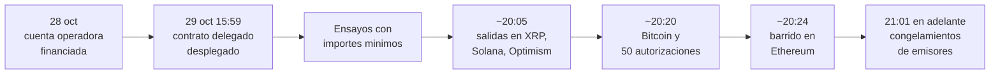
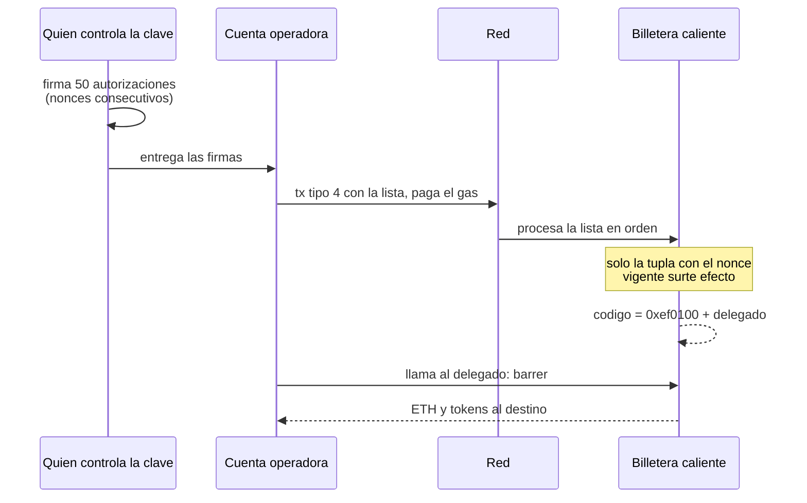

# Bloque 9 · Estudio de caso: incidente de Binance del 29 de octubre de 2026

> 🧭 [⬅️ Bloque 8 · Pruebas de reservas](08-pruebas-de-reservas-y-sus-limites.md) · [🛡️ Especialización](../README.md) · [🧪 Laboratorios](../laboratorios/README.md) · [🧮 Matriz](../MATRIZ-INTEGRACION.md)

**Nivel:** avanzado · **Duración:** 4–6 h · **Prerrequisitos:** bloques 1 a 8 · **Laboratorios que lo ponen a prueba:** [LE4](../laboratorios/LE4-delegacion-eip7702.md), [LE5](../laboratorios/LE5-detector-delegaciones.md), [LE7](../laboratorios/LE7-flujos-multidireccion.md) y [LE8](../laboratorios/LE8-monitor-riesgos-custodio.md)

> **Estudio vivo, con fecha de corte: 30 de octubre de 2026.** El incidente tiene horas de antigüedad. Las cifras se mueven, Binance ha anunciado un informe técnico posterior que todavía no existe, y las empresas de análisis de cadena actualizan sus cálculos. Este documento fija **qué se sabía a esa fecha y con qué grado de certeza**, no qué ocurrió "de verdad". Cuando aparezca el informe de Binance, el procedimiento de [actualización](#cómo-actualizar-este-estudio) indica qué filas deben reabrirse.

## Punto de partida

**Pregunta guía:** ¿qué falló, en qué orden, y qué de lo que se afirma hoy sobrevivirá al informe definitivo?

Este caso es valioso por dos razones opuestas. Es el incidente de custodia más grande registrado y mezcla casi todas las ideas del programa: firmas, nonces, delegación de código, hot wallets, varias cadenas, stablecoins congelables y activos que no se pueden congelar. Y al mismo tiempo es un caso **incompleto**: su causa raíz no está publicada. Aprender a trabajar con un caso así —sin rellenar los huecos con certezas inventadas— es la habilidad forense central.

## Regla de lectura: tres categorías y una prohibición

Cada afirmación del estudio pertenece a una de estas categorías. La clasificación importa más que el dato.

| Categoría | Qué significa | Qué se puede hacer con ella |
|---|---|---|
| **Hecho confirmado** | Verificable on-chain por cualquiera, o declarado en el registro por la propia entidad, o coincidente en fuentes independientes. | Citarla como base de un análisis. |
| **Hipótesis** | Inferencia razonada de un tercero a partir de hechos. Puede ser correcta. No está confirmada por quien tiene la información. | Usarla para planificar controles, nombrándola como hipótesis. |
| **Desconocido** | Dato que nadie ha publicado. | Registrarlo como pregunta abierta; nunca rellenarlo. |

**La prohibición:** este estudio no atribuye conducta a ninguna persona. Que el acceso inicial haya sido, según Binance, un equipo de ingeniería comprometido describe una cadena de ataque, no una responsabilidad individual. La atribución a un grupo es una evaluación de terceros con su nivel de confianza declarado, no una identificación. Aplica [¿Y si cruzas la línea?](../../docs/y-si-cruzas-la-linea-blockchain.md).

## Línea de tiempo (UTC) con la fuente de cada fila

Las horas proceden de dos fuentes técnicas distintas y no coinciden en todo; las discrepancias se tratan después.

| Hora (UTC) | Qué ocurrió | Fuente | Categoría |
|---|---|---|---|
| 28 oct, mañana | Una cuenta operadora recibe tres retiros pequeños desde Tornado Cash | [TRM](https://www.trmlabs.com/resources/blog/north-korea-steals-usd-6-36-billion-from-binance-in-the-largest-hack-in-history), [Blockaid](https://blockaid.io/blog/binance-55b-hack-using-advanced-ai-models-blockaid-detects-the-biggest-theft-in-crypto-history) | Hecho (on-chain, dos fuentes) |
| 29 oct, 15:59 | Se despliega el contrato delegado del atacante | Blockaid | Hecho (una fuente técnica; verificable on-chain) |
| 29 oct, antes | Ensayos del código en tres billeteras con importes de 2 a 6 USD (Blockaid); TRM los describe como pruebas en dos billeteras y un ensayo final en una tercera | Blockaid, TRM | Hecho (dos fuentes, con diferencia en el detalle) |
| 20:05–20:09 | Cinco billeteras de XRP Ledger envían 233,46 millones de XRP | TRM | Hecho (una fuente; verificable en cadena) |
| ~20:10 | Se vacían billeteras de Solana y Optimism | TRM | Hecho (una fuente) |
| ~20:20 | La billetera caliente de Bitcoin envía 18 270 BTC, fraccionados en piezas de 1 000 y 100 BTC en el mismo bloque | TRM | Hecho (una fuente) |
| ~20:20:59 | Una transacción tipo 4 con 50 autorizaciones EIP-7702 apunta a la billetera caliente de Ethereum | Blockaid, TRM | Hecho (dos fuentes) |
| ~20:24 | Barrido de ETH y tokens de esa billetera (unos 167 464 ETH y 1 615 millones de USDT) | TRM, Blockaid | Hecho (dos fuentes) |
| 20:41 | Con la delegación aún activa, se mueve USDC desde una cuenta inteligente de Binance | Blockaid | Hecho (una fuente) |
| 21:01–21:04 | Primeros congelamientos de Tether y Circle | TRM | Hecho (una fuente; verificable en los contratos) |
| 21:44 | Segundo barrido de la billetera caliente de Ethereum con fondos depositados después | Blockaid | Hecho (una fuente) |
| 22:00 | La delegación sigue activa | Blockaid | Hecho (una fuente) |
| ~23:05 | Segunda oleada: Avalanche y Polygon | TRM | Hecho (una fuente) |
| 23:35 | Binance reporta unos 2 540 millones de USD verificados como congelados | TRM (cita a Binance) | Hecho como declaración, cifra provisional |

## Lo que se sabe: hechos confirmados

### Del lado declarado por Binance

1. Binance reconoció un incidente de seguridad y suspendió depósitos y retiros ([TechCrunch](https://techcrunch.com/2026/10/29/binance-pauses-withdrawals-as-hackers-suspected-of-stealing-billions-in-crypto/), [Al Jazeera](https://www.aljazeera.com/economy/2026/10/30/binance-says-2-54bn-in-crypto-funds-frozen-amid-potential-security-issue)).
2. Binance estima en unos **6 300 millones de USD** lo sustraído y en unos **3 000 millones** lo congelado a esa fecha (Al Jazeera).
3. Una investigación inicial de Binance sugiere que un atacante hizo transacciones no autorizadas tras acceder a **un portátil comprometido de un ingeniero** (Al Jazeera).
4. Binance afirma que cubrirá las pérdidas, que colabora con las autoridades y que publicará un informe técnico detallado cuando concluya la investigación ([Al Jazeera](https://www.aljazeera.com/economy/2026/10/30/binance-says-2-54bn-in-crypto-funds-frozen-amid-potential-security-issue)). CNBC añade que la cobertura se haría con su fondo de protección de usuarios ([CNBC](https://www.cnbc.com/2026/10/30/binance-hack-stolen-crypto-recovery.html)); Al Jazeera no lo menciona.

### Del lado verificable en cadena

5. **Salidas en diez cadenas**: Ethereum, Bitcoin, Tron, XRP Ledger, Solana, Arbitrum, Optimism, Base, Avalanche y Polygon ([TRM](https://www.trmlabs.com/resources/blog/north-korea-steals-usd-6-36-billion-from-binance-in-the-largest-hack-in-history)). La mayor parte en unos veinte minutos.
6. **En Ethereum, una transacción tipo 4 (EIP-7702)** con **50 autorizaciones firmadas con la clave de la billetera caliente**, enviada por una cuenta operadora financiada vía Tornado Cash. Solo una coincidía con el nonce vigente ([Blockaid](https://blockaid.io/blog/binance-55b-hack-using-advanced-ai-models-blockaid-detects-the-biggest-theft-in-crypto-history), [TRM](https://www.trmlabs.com/resources/blog/north-korea-steals-usd-6-36-billion-from-binance-in-the-largest-hack-in-history)). Chainalysis describe el mismo mecanismo ([Chainalysis](https://www.chainalysis.com/blog/binance-exploit-latest-findings-and-response/)).
7. **El contrato delegado solo obedecía a un operador** y tenía funciones de barrido y de reenvío de llamadas (Blockaid). Estaba sin verificar.
8. **En las otras nueve cadenas se usaron transferencias firmadas normales**, no delegación (TRM). Es la observación que más pesa en las hipótesis.
9. **Los emisores congelaron**: Tether, Circle, Ripple (RLUSD), World Liberty Financial (USD1) y el Consejo de Seguridad de Arbitrum (transferencia forzada) (TRM). Los importes exactos varían con el momento del corte.
10. **Parte de lo robado se movió a activos no congelables** rápidamente: unos 325 millones de USDT se vendieron por ETH, y se tomaron préstamos contra stablecoins (TRM, Chainalysis, CNBC).

## Lo que se sospecha: hipótesis, cada una con su razón y su punto débil

| # | Hipótesis | Quién la formula | En qué se apoya | Punto débil |
|---|---|---|---|---|
| H1 | La **infraestructura de firma** de las billeteras calientes fue comprometida | TRM, de forma explícita como "explicación más probable" | Diez cadenas con firmas válidas en unos 30 minutos, casi todas por transferencias normales | Es compatible con una clave exfiltrada **y** con un servicio de firma abusado: no distingue entre ambas |
| H2 | El acceso inicial fue un **equipo de ingeniería comprometido** | Binance ("investigación inicial sugiere") | Declaración de la empresa | Es el eslabón inicial, no la ruta completa hasta el material de firma |
| H3 | Autoría del grupo norcoreano **TraderTraitor** | TRM ("alta confianza"), Chainalysis ("evalúa") | Mezcla en cadena con fondos de un robo anterior a Bitget; similitudes de método con Bybit y KelpDAO; financiación vía Tornado Cash | Binance no la ha confirmado; las pruebas completas no son públicas; la mezcla de fondos prueba proximidad, no identidad |
| H4 | Las autorizaciones fueron **obtenidas por engaño** (phishing de firma) | Hipótesis temprana en la prensa | Es el patrón conocido en EIP-7702 | TRM la considera incompleta: solo explicaría Ethereum, no las otras nueve cadenas |
| H5 | Los fondos pasarán por **puentes, intercambios y mesas OTC** | TRM, CNBC (investigadores) | Patrones previos | Es un pronóstico, no un hecho observado |

> **Atención a lo que no es una hipótesis del caso.** Algún resumen de prensa menciona un "contenedor de servicio" como vía de acceso. En el artículo original consultado no aparece; Binance habla de un portátil. Un dato que circula pero que no puedes localizar en una fuente primaria se registra como **no verificado**, no como hipótesis.

## Lo que no se sabe: desconocidos

Esta lista es el núcleo del estudio. Un buen informe la mantiene visible.

| # | Pregunta abierta | Por qué importa |
|---|---|---|
| U1 | ¿Cuál fue la **causa raíz** y el vector exacto de acceso inicial? | Determina qué control habría evitado el incidente |
| U2 | ¿Se **copiaron claves** o se **abusó de un servicio de firma**? | Cambia por completo el control eficaz: un freno de emergencia solo ayuda en el segundo caso ([LE8](../laboratorios/LE8-monitor-riesgos-custodio.md)) |
| U3 | ¿Cómo estaban **custodiadas** esas claves: HSM, MPC, servidores, un solo entorno? ¿Cuántas eran de la misma capa? | Responde si "once claves" eran once defensas o una |
| U4 | ¿En qué **orden** iba la lista de 50 autorizaciones? | Con orden ascendente se encadenan varias; con descendente se aplica una ([LE4](../laboratorios/LE4-delegacion-eip7702.md)). Las fuentes dicen "una coincidió" sin publicar el orden |
| U5 | ¿Desde **cuándo** tuvo acceso el atacante? | Lo único visible es la preparación de, como mínimo, un día; el acceso previo es invisible desde fuera |
| U6 | ¿Por qué las billeteras calientes tenían **saldos tan altos**? | Es el factor que fijó el tamaño de la pérdida |
| U7 | ¿Qué parte se **recuperará**? | Depende de lo ya convertido a activos sin emisor |
| U8 | ¿Cuál es la **evidencia completa** de la atribución? | Las firmas de análisis publican conclusiones, no siempre todos los indicadores |
| U9 | ¿Cuáles son las **cifras definitivas**? | Ver la tabla de discrepancias |
| U10 | ¿Cuándo y cómo se **revocó** la delegación de la billetera caliente? | Mientras estuvo activa, los depósitos nuevos eran alcanzables sin firma nueva |
| U11 | ¿Cuál es la **capacidad real de absorción** de la pérdida (fondo de reserva, capital, seguros)? | La promesa de cubrir todas las pérdidas es una declaración de capacidad, no una prueba de ella ([bloque 8](08-pruebas-de-reservas-y-sus-limites.md)) |

## Discrepancias entre fuentes: cómo se lee

Dos cifras distintas para lo "mismo" casi nunca son un error: suelen medir cosas distintas. Antes de elegir una, pregunta **qué mide, a qué precio y a qué hora**.

| Magnitud | Valores publicados | Por qué difieren |
|---|---|---|
| Monto sustraído | 5 500 M (Blockaid, titular) · 6 300 M (Binance) · 6 360 M (TRM) · 6 400 M (Chainalysis) | Valoración a precio de cada transferencia frente a precio actual; qué activos se incluyen; momento del corte |
| Congelado | 2 540 M (Binance a las 23:35, vía TRM) · ~2 700 M (TRM) · ~2 800 M (Chainalysis) · ~3 000 M (Binance, Blockaid, CNBC) | Cada cifra es una foto a una hora distinta: los congelamientos siguieron llegando |
| Inicio de las salidas | 20:05 (TRM, XRP) · ~20:20 (Chainalysis, Blockaid) | Primera salida de cualquier cadena frente a primera actividad en Ethereum. Chainalysis publica en hora del este y la conversión a UTC es una suposición |
| Claves implicadas | "Once claves" (Blockaid) · "diez cadenas" (TRM) | Una cuenta cuenta claves; la otra cuenta redes |
| Cadena de la mezcla | Fondeo de la cuenta operadora vía Tornado Cash · "sin señales de mezcladores" en el lavado posterior (CNBC, citando a Chainalysis) | No se contradicen: una frase habla de la preparación, la otra del lavado posterior |

## Análisis técnico: el mecanismo en Ethereum

El atacante necesitaba que la billetera caliente de Ethereum **ejecutara código suyo**. Antes de EIP-7702 eso era imposible para una cuenta de clave. Con EIP-7702 basta una firma: ver [bloque 2](02-cuentas-contratos-y-abstraccion.md) y [bloque 4](04-delegacion-de-permisos.md).

Tres propiedades del mecanismo explican la dimensión del incidente:

- **La firma de autorización no necesita ninguna transacción de la cuenta.** El remitente fue la cuenta operadora; la billetera caliente solo aportó una firma. Un monitor que vigile "transacciones enviadas por la billetera caliente" **no ve nada**.
- **La ventana de nonces resuelve el problema del atacante.** La billetera seguía procesando retiros, así que no podía saber su nonce exacto. Firmar una ventana de 50 hace que alguna acierte. El detalle exacto de cómo se comporta la ventana depende del orden ([LE4](../laboratorios/LE4-delegacion-eip7702.md)).
- **La delegación persiste.** Siguió activa durante horas y permitió barrer los depósitos que llegaron después (Blockaid, 21:44 y 22:00).

Lo que **no** explica el mecanismo: las otras nueve cadenas. Allí no hay un equivalente de EIP-7702 y las salidas fueron transferencias firmadas ordinarias. Por eso la pregunta decisiva sobre el caso no es técnica sobre Ethereum, sino de **custodia**: ¿qué tuvo el atacante para que todas esas firmas existieran?

## Qué controles habrían cambiado el resultado (y cuáles no)

Cada control se evalúa contra las dos hipótesis centrales sobre el acceso (U2). Es la tabla que replica el [laboratorio LE8](../laboratorios/LE8-monitor-riesgos-custodio.md).

| Control | Si se abusó del servicio de firma | Si se copió la clave | Fuente del razonamiento |
|---|---|---|---|
| Tope de saldo en la billetera caliente | Acota la pérdida | Acota la pérdida | Es el único que actúa en ambos casos |
| Política de firma que **rechaza firmar autorizaciones EIP-7702** desde claves de billetera caliente | Habría impedido el vector en Ethereum | No actúa: quien tiene la clave firma fuera del servicio | [Bloque 3](03-custodia-claves-y-politicas-de-firma.md) |
| Lista de destinos permitidos aplicada **en la capa de firma** | Bloquea | No actúa | [Bloque 3](03-custodia-claves-y-politicas-de-firma.md) |
| Freno de emergencia automático ante salidas en varias cadenas | Detiene lo que queda | No detiene nada | LE8 |
| Conciliación continua del nonce con el esperado | Detecta firmas fuera del flujo | Detecta firmas fuera del flujo | [LE5](../laboratorios/LE5-detector-delegaciones.md), [LE8](../laboratorios/LE8-monitor-riesgos-custodio.md) |
| Claves distintas e **independientes en infraestructura** por cadena | Limita la propagación | Limita la propagación | [Bloque 3](03-custodia-claves-y-politicas-de-firma.md) |
| Relaciones previas con emisores para congelar rápido | Reduce lo irrecuperable | Reduce lo irrecuperable | [Bloque 6](06-stablecoins-congelamiento-y-recuperacion.md) |

**Lectura honesta de la tabla:** varios controles solo sirven en una de las hipótesis. Mientras U2 siga abierta, la conclusión correcta no es "faltó el control X", sino "los controles que actúan en **ambos** casos eran la exposición máxima y la detección". Este razonamiento por hipótesis es el producto del estudio.

## Ejercicio guiado

1. **Clasifica.** Toma diez afirmaciones de cualquier artículo sobre el incidente y clasifícalas en hecho, hipótesis, desconocido o no verificado. Anota la fuente primaria de cada una; si no la hay, di por qué la clasificas como no verificada.
2. **Verifica por tu cuenta.** Con el [explorador LE6](../laboratorios/LE6-explorador-transacciones.md) en modo en vivo, comprueba contra un nodo público el código de la billetera caliente de Ethereum (`eth_getCode`) y si lleva el designador `0xef0100`. Obtén las direcciones y los hash de los informes originales y contrástalos con más de una fuente antes de usarlos: este material no los reproduce a propósito, para que no se propaguen errores de transcripción.
3. **Reproduce el patrón.** Ejecuta `escenarioVentanaDeNonces` en LE4 con ambos órdenes y explica qué cambia para U4.
4. **Mide la exposición.** Con los datos sintéticos de LE8, explica por qué `base-con-topes` reduce la pérdida a una fracción incluso si la clave fue copiada.
5. **Redacta una declaración honesta.** Escribe, en doce líneas, qué diría una entidad afectada a sus clientes a las 24 horas: solo hechos confirmados, lo que se está investigando y cuándo habrá novedades.

### Respuestas orientadoras

- La declaración honesta no promete una causa. Dice qué se contuvo, qué importe está identificado, qué se congeló, qué se desconoce y cuándo se actualizará.
- En el ejercicio 4, la pérdida con clave copiada baja porque el tope fija cuánto valor había expuesto en cada cadena: el freno no participa.
- En el ejercicio 2, una respuesta `0x` en `eth_getCode` indica cuenta sin delegar; un valor de 23 bytes que empieza por `0xef0100` indica delegación activa.

## Cómo actualizar este estudio

Cuando Binance publique su informe técnico:

1. Anota la fecha y la URL en la tabla de fuentes y **no borres** las filas antiguas: márcalas como resueltas o refutadas.
2. Reabre U1 a U11. Cada una pasa a hecho, a hipótesis refutada, o sigue como desconocida.
3. Revisa H1 a H5: ¿alguna se confirmó, se descartó o se matizó?
4. Contrasta las cifras definitivas con la tabla de discrepancias y conserva la antigua como historial.
5. Reevalúa la tabla de controles: la columna que quede sin sentido (por ejemplo, si se descarta la copia de clave) se simplifica.
6. Ejecuta `node scripts/check-repository.mjs` para comprobar que el estudio sigue conteniendo las tres categorías.

## Errores frecuentes al estudiar este caso

- **Convertir una hipótesis en un hecho porque muchos medios la repiten.** Repetir no es verificar: las coincidencias de prensa suelen remontarse a una sola fuente.
- **Atribuir la vulnerabilidad a Ethereum.** TRM indica que el incidente refleja un compromiso de la infraestructura de firma, no un fallo del protocolo. EIP-7702 es el vehículo en una cadena, no la causa.
- **Elegir la cifra más llamativa.** Cada cifra mide algo distinto.
- **Pensar que congelar equivale a recuperar.** Un congelamiento detiene fondos; devolverlos requiere decisiones del emisor y de las autoridades ([bloque 6](06-stablecoins-congelamiento-y-recuperacion.md)).
- **Dar por buenas direcciones y hash copiados de resúmenes.** Un solo carácter equivocado apunta a otra cuenta.

## Fuentes y cómo se consultaron

| Fuente | Tipo | Se usa para |
|---|---|---|
| [TRM Labs · North Korea steals USD 6.36 billion from Binance](https://www.trmlabs.com/resources/blog/north-korea-steals-usd-6-36-billion-from-binance-in-the-largest-hack-in-history) | Análisis de cadena | Cronología multicadena, congelamientos, hipótesis de infraestructura |
| [Chainalysis · Binance exploit: latest findings](https://www.chainalysis.com/blog/binance-exploit-latest-findings-and-response/) | Análisis de cadena | Atribución, lavado inicial, mecanismo general |
| [Blockaid · Binance hack](https://blockaid.io/blog/binance-55b-hack-using-advanced-ai-models-blockaid-detects-the-biggest-theft-in-crypto-history) | Análisis técnico | Detalle de las 50 autorizaciones y del contrato delegado |
| [TechCrunch · Binance pauses withdrawals](https://techcrunch.com/2026/10/29/binance-pauses-withdrawals-as-hackers-suspected-of-stealing-billions-in-crypto/) | Prensa | Primera declaración de Binance |
| [Al Jazeera · Binance says $6.3bn stolen](https://www.aljazeera.com/economy/2026/10/30/binance-says-2-54bn-in-crypto-funds-frozen-amid-potential-security-issue) | Prensa | Declaración de Binance sobre causa, importe y congelado |
| [CNBC · Investigators in a cat and mouse game](https://www.cnbc.com/2026/10/30/binance-hack-stolen-crypto-recovery.html) | Prensa | Perspectivas de recuperación y límites de los congelamientos |
| [EIP-7702](https://eips.ethereum.org/EIPS/eip-7702) | Especificación | Reglas de procesamiento de las autorizaciones |

**Límites de este estudio.** Las fuentes técnicas son informes de empresas de análisis, no comunicados de la entidad afectada; varias cifras son de una sola fuente; no hay informe técnico de Binance; el corte es de pocas horas tras el incidente. Todo lo que dependa de estos puntos se ha marcado como tal.

## ✅ Criterio de dominio

Sabes estudiar un incidente incompleto cuando puedes, sin consultar este documento, clasificar una afirmación nueva en hecho, hipótesis, desconocido o no verificado; explicar por qué dos cifras distintas pueden ser ambas correctas; y razonar qué control habría actuado bajo cada hipótesis sobre el acceso.

## 🧭 Navegación

⬅️ [Bloque 8 · Pruebas de reservas](08-pruebas-de-reservas-y-sus-limites.md) · [🛡️ Especialización](../README.md) · [🧪 Laboratorios](../laboratorios/README.md) · [📖 Glosario](../glosario.md) · [🏠 Programa](../../README.md)
