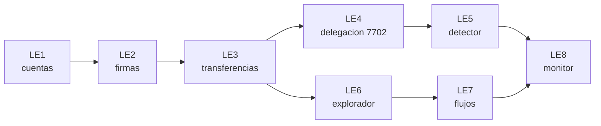

# 🧪 Laboratorios de la especialización

> 🧭 [🛡️ Especialización](../README.md) · [🧮 Matriz de integración](../MATRIZ-INTEGRACION.md) · [📝 Evaluación](../evaluacion/README.md) · [📖 Glosario](../glosario.md) · [🏠 Programa](../../README.md)

Ocho laboratorios ejecutables, todos **offline, deterministas y sin dependencias**: solo Node.js. Cada uno tiene guía, código comentado, pruebas automáticas, resultados esperados, ejercicios adicionales y soluciones. Se identifican como **LE1–LE8** (laboratorio de especialización) y **no alteran** la numeración de las 91 prácticas del [catálogo](../../labs/CATALOG.md).

## Los ocho laboratorios

| Lab | Qué construyes | Pregunta que responde | Guía | Pruebas |
|---|---|---|---|---|
| **LE1** | Billeteras de prueba y checksum de direcciones | ¿Qué es una cuenta y qué hace "de prueba" a una clave? | [LE1](LE1-billeteras-de-prueba.md) | 8 |
| **LE2** | Firmas: verificar, maleabilidad, repetición, fuga por nonce | ¿Qué prueba exactamente una firma? | [LE2](LE2-firmas-digitales.md) | 11 |
| **LE3** | Transferencias entre direcciones controladas | ¿Qué valida la red antes de mover valor? | [LE3](LE3-transferencias-simuladas.md) | 7 |
| **LE4** | Delegación EIP-7702 en una red de laboratorio | ¿Qué cambia en una cuenta cuando delega? | [LE4](LE4-delegacion-eip7702.md) | 11 |
| **LE5** | Detector de delegaciones sospechosas | ¿Cómo se distingue lo legítimo de lo hostil con datos públicos? | [LE5](LE5-detector-delegaciones.md) | 16 |
| **LE6** | Explorador de transacciones públicas | ¿Cómo leo una transacción sin confiar en un explorador? | [LE6](LE6-explorador-transacciones.md) | 15 |
| **LE7** | Análisis de flujos entre direcciones y cadenas | ¿Cuánto de lo recibido es robado y qué se puede congelar? | [LE7](LE7-flujos-multidireccion.md) | 17 |
| **LE8** | Monitor de riesgos para custodios | ¿Qué vigilar y qué puede hacer realmente la defensa? | [LE8](LE8-monitor-riesgos-custodio.md) | 17 |

Además, el **núcleo criptográfico compartido** (`labs/especializacion-seguridad/nucleo/`) tiene 43 pruebas: Keccak-256, secp256k1 con recuperación de clave pública, RLP, direcciones EIP-55, transacciones tipo 2 y tipo 4, y la red de laboratorio. Se comprueba contra vectores públicos conocidos.



## Requisitos y ejecución

- **Node.js 22.12 o superior.** Sin `npm install` para estos laboratorios.
- Desde la raíz del repositorio, cada laboratorio se ejecuta con `node` o con su atajo de `pnpm`:

| Lab | Con node | Con pnpm |
|---|---|---|
| LE1 | `node labs/especializacion-seguridad/le1-billeteras-de-prueba.mjs` | `pnpm lab:le1` |
| LE2 | `node labs/especializacion-seguridad/le2-firmas-digitales.mjs` | `pnpm lab:le2` |
| LE3 | `node labs/especializacion-seguridad/le3-transferencias-simuladas.mjs` | `pnpm lab:le3` |
| LE4 | `node labs/especializacion-seguridad/le4-delegacion-eip7702.mjs` | `pnpm lab:le4` |
| LE5 | `node labs/especializacion-seguridad/le5-detector-delegaciones.mjs` | `pnpm lab:le5` |
| LE6 | `node labs/especializacion-seguridad/le6-explorador-transacciones.mjs` | `pnpm lab:le6` |
| LE7 | `node labs/especializacion-seguridad/le7-flujos-multidireccion.mjs` | `pnpm lab:le7` |
| LE8 | `node labs/especializacion-seguridad/le8-monitor-riesgos-custodio.mjs` | `pnpm lab:le8` |

- Todas las pruebas de la especialización a la vez:

```bash
node --test labs/especializacion-seguridad/*.test.mjs labs/especializacion-seguridad/nucleo/*.test.mjs
```

## Reglas comunes (innegociables)

1. **Solo claves de prueba.** Todas las claves de los laboratorios se derivan de etiquetas públicas ([LE1](LE1-billeteras-de-prueba.md)) y no protegen nada. Nunca uses una clave real en un laboratorio ni una de laboratorio con valor real. Las bitácoras no incluyen claves, semillas ni endpoints privados.
2. **Sin red por defecto.** Ningún laboratorio hace peticiones de internet salvo LE6 en modo en vivo, que es opcional, explícito y de solo lectura.
3. **Datos sintéticos.** Las direcciones, hash, importes y entidades de los conjuntos de datos no corresponden a nadie real. Imitan la *forma* de patrones descritos públicamente, no copian cifras ni direcciones.
4. **Nada ofensivo.** La red de laboratorio no ejecuta bytecode ni sirve para desplegar nada. El «delegado hostil» es una función de dos transferencias que solo existe para enseñar la forma del daño y su detección.
5. **Una dirección no es una persona.** Ningún laboratorio atribuye identidad. Toda inferencia lleva su categoría y su confianza.

## Cómo trabajar un laboratorio

1. **Lee la teoría y la hipótesis.** Escribe qué crees que va a ocurrir antes de ejecutar.
2. **Ejecuta** el laboratorio y compara con los resultados esperados.
3. **Ejecuta las pruebas** y lee las que fallarían si rompieras una regla: modifica el código y comprueba que fallan.
4. **Resuelve los ejercicios adicionales** antes de abrir las soluciones.
5. **Registra la evidencia** en tu bitácora: comando, resultado resumido, qué te sorprendió y el límite de lo demostrado.

La evaluación y las rúbricas están en [evaluación](../evaluacion/README.md).

## 🧭 Navegación

[🛡️ Especialización](../README.md) · [🧮 Matriz de integración](../MATRIZ-INTEGRACION.md) · [📝 Evaluación](../evaluacion/README.md) · [📖 Glosario](../glosario.md) · [🏠 Programa](../../README.md)
